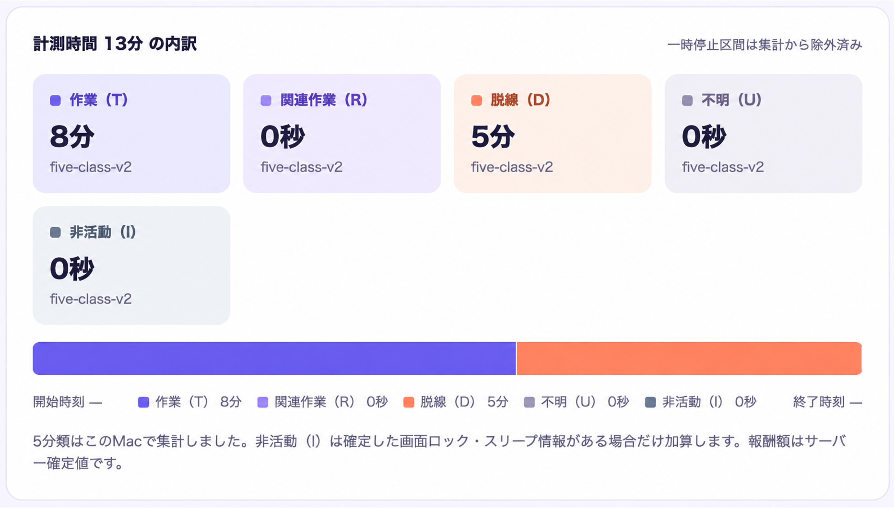
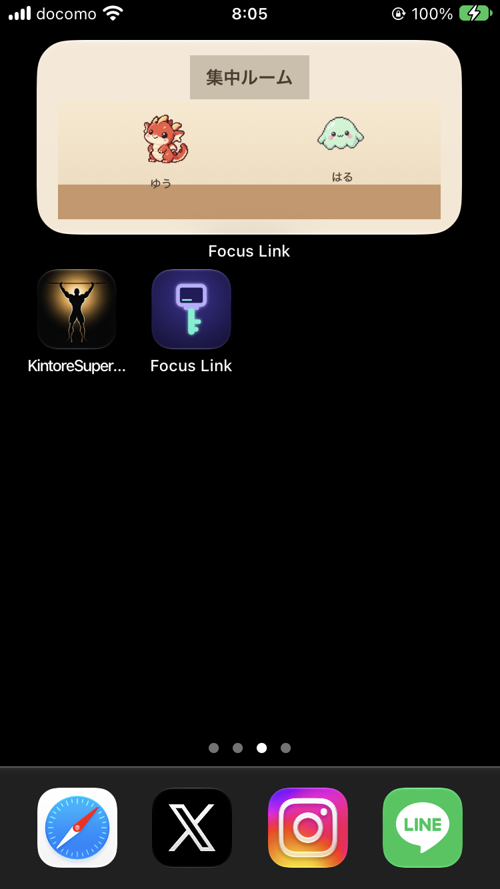

# Focus Link

**PCでの頑張りを、スマホの自由時間に。友達と一緒に、集中を続ける。**

※画像をクリックすると、デモ動画を開けます。

## 製品概要

### 背景（製品開発のきっかけ・課題）

レポートや仕事など、やるべきことがあっても、スマホが気になって作業が進まないことがあります。Focus Linkは、特に次のような悩みを持つ人に向けて開発しました。

- **作業を始められない**：タスクがあるのに、スマホから離れられない。
- **作業に戻れない**：途中でスマホを見始めると、そのまま休憩が長引いてしまう。

友達が頑張っている姿を作業開始のきっかけにし、自分の頑張りをスマホの自由時間につなげることで、作業を始めて続ける習慣を支援します。

### 製品説明（具体的な製品の説明）

Focus Linkは、**PCでの作業に応じて、iPhoneの娯楽アプリを使える「報酬時間」がたまる**集中習慣支援サービスです。学生のレポートや研究、プログラミング、社会人の資料作成など、PCで取り組む作業を対象としています。

PCで作業を始めると、iPhoneで選んだアプリの利用を自動で制限します。休憩するときは、獲得した報酬時間の範囲でそのアプリを利用できます。また、友達の作業中の状態をiPhoneのウィジェットで確認でき、自分も作業を始めるきっかけになります。

### 解決できること

| 困りごと | Focus Linkの支援 |
| --- | --- |
| スマホから離れられず、作業を始められない | ウィジェットや通知で友達が作業中だと分かり、「自分も始めよう」と思えるきっかけを作ります。 |
| 作業中にスマホへ脱線し、そのまま戻れない | PCの作業開始・再開に連動して対象アプリを制限し、報酬時間を使った休憩と作業を切り替えられるようにします。 |

### 使い方

事前にPCとiPhoneで同じアカウントにログインし、iPhoneで利用を制限するアプリを選びます。

1. **作業を始める**：PCで取り組むタスクを選んで開始すると、iPhoneの対象アプリが制限されます。
2. **報酬時間をためる**：PCの作業記録をもとに、報酬時間を獲得します。
3. **休憩する**：PCの作業を一時停止し、iPhoneで報酬時間を使って対象アプリを利用します。
4. **作業に戻る**：PCで作業を再開すると、対象アプリに再び制限がかかります。

### 特長

#### 1. 作業を始める入口を複数用意

PCアプリ起動時の案内や、macOSのメニューバー・Windowsのタスクトレイから、すぐに作業画面を開けます。途中の作業があれば再開でき、グループの友達から届く作業開始通知も、着手のきっかけになります。

#### 2. PC上の作業状況を記録し、結果を見える化

PCで使っているアプリや、対応ブラウザーで閲覧しているサイトのドメイン、操作していない時間を記録します。その記録をルールに沿って**作業・関連作業・脱線・不明・非活動**の5種類に分け、結果画面で時間の内訳と判定の根拠を表示します。URL全体、ページタイトル、キー入力の内容、画面画像は保存・送信しません。

#### 3. 休憩と作業再開までを一つの流れに

iPhoneでは、自分が制限対象に選んだアプリを、報酬時間の範囲で利用できます。残り時間は対象アプリを実際に使った分だけ減ります。PCで作業を再開すると、利用可能な時間が残っていても対象アプリを再び制限し、作業に戻る流れを作ります。

#### 4. 友達と作業中の状態を共有

友達とグループを作り、作業中の状態を共有できます。作業中の友達がiPhoneのホーム画面にキャラクターで表示されるため、スマホを手に取ったときに「自分も頑張ろう」と思えるきっかけになります。

#### 5. macOS・Windowsに対応

macOSではメニューバー、Windowsではタスクトレイから作業画面にアクセスでき、手軽に作業を始められます。

### 今後の展望

- 作業後の自己評価とPC上の作業記録を組み合わせ、利用者ごとの集中しやすい条件を把握する材料にします。
- 習慣化の状況に合わせて報酬の条件を調整し、固定された条件に慣れて効果が薄れる可能性に対応します。
- 作業ログをタスクの進捗や成果物と結びつけ、PCを操作した時間だけでなく、実際に作業が進んだかも評価できるようにします。

### 注力したこと（こだわり等）

#### アイデア面

- 報酬を仮想ポイントやスマホ内のキャラクター育成ではなく、本人が実際に使いたいスマホの利用時間にしました。作業と報酬の価値を直接結びつける設計です。
- アプリ起動時の案内、メニューバー／タスクトレイからの開始、グループメンバーの開始通知を用意し、本人の意志だけに頼らず作業を始める入口を作ります。

#### 技術面

- **機能ごとに分けたバックエンド**：モジュラーモノリスとクリーンアーキテクチャを採用し、作業記録・報酬・利用制限などの処理を分離しています。
- **PC・iPhoneで共通のAPI定義**：Protocol Buffersで通信データの型を定義し、Bufで関連コードの生成を管理しています。
- **APIの入口でのリクエスト検査**：Cloudflare Workerで接続を受け、アクセス先や認証ヘッダー形式、データの種類・サイズを検査し、IP単位でリクエスト数を制限する構成です。Terraformコードは用意済みですが、クラウドへの適用は未実施です。
- **画面とPC内の処理を連携**：Wails v2とReactを組み合わせ、Goで実装した作業計測などの処理を画面から操作できるようにしています。

## 開発技術

### 活用した技術

#### API・データ

- Supabase Auth／Supabase PostgreSQL
- Connect RPC（Protocol Buffers / Bufで定義したAPI）
- Apple Screen Time API（FamilyControls・ManagedSettings・DeviceActivity）による娯楽アプリの制限・一時解除
- Apple Push Notification service（APNs）によるグループの作業開始通知
- Google Cloud Run／Artifact Registry／Secret Manager、Cloudflare Workers、Terraform、GitHub Actions

#### フレームワーク・ライブラリ・モジュール

- バックエンド：Go、connect-go、pgx、sqlc、goose、golang-jwt
- デスクトップ：Wails v2、React 19、TypeScript、Vite、99designs/keyring（macOS Keychain／Windows資格情報ストア）
- iPhone：Swift / SwiftUI、Supabase Swift SDK、WidgetKit

#### デバイス

- macOS・Windows（デスクトップアプリ：作業の設定・計測・結果表示）
- iPhone（報酬時間の利用・娯楽アプリの利用制限・ウィジェット）

### 独自技術

#### ハッカソンで開発した独自機能・技術

- **PC作業ログとセッション報酬の連携**：作業セッションの状態・活動記録・報酬の確定を連携します。[デスクトップの活動同期](desktop/internal/app/activity_sync.go)、[セッション処理](backend/internal/workflow/application/sessions.go)、[報酬ルール](backend/internal/reward/domain/reward.go)
- **iPhoneの利用枠と実利用時間の連携**：Screen Timeの許可・制限状態と利用枠を扱います。[Screen Time制御](mobile/RewardTime/Data/MobileScreenTimeController.swift)、[利用時間モニター](mobile/RewardTime/Data/DeviceActivityUsageMonitor.swift)、[利用枠ドメイン](backend/internal/restriction/domain/restriction.go)。DeviceActivityや期限後の再制限など、実機での受け入れ確認は継続中です。
- **API入口Proxyによるリクエスト検査**：許可ルート・認証形式・リクエストサイズの確認と、IP単位のレート制限を行います。[WorkerのProxy処理](infra/modules/cloudflare/api-endpoint/worker/proxy.js)、[Cloudflare WorkerのTerraform設定](infra/modules/cloudflare/api-endpoint/main.tf)。Terraformの検証は済んでいますが、クラウドへの適用は未実施です。

## 開発・起動手順

環境構築や起動方法は、各ディレクトリのREADMEを参照してください。

- [デスクトップアプリ](desktop/README.md)
- [iPhoneアプリ](mobile/README.md)
- [バックエンド](backend/README.md)
- [インフラ](infra/README.md)
