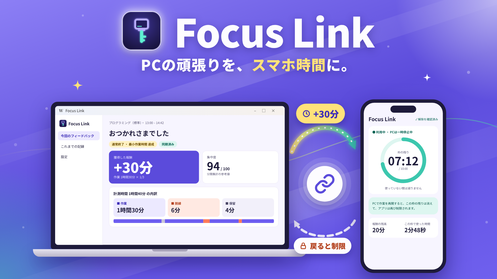
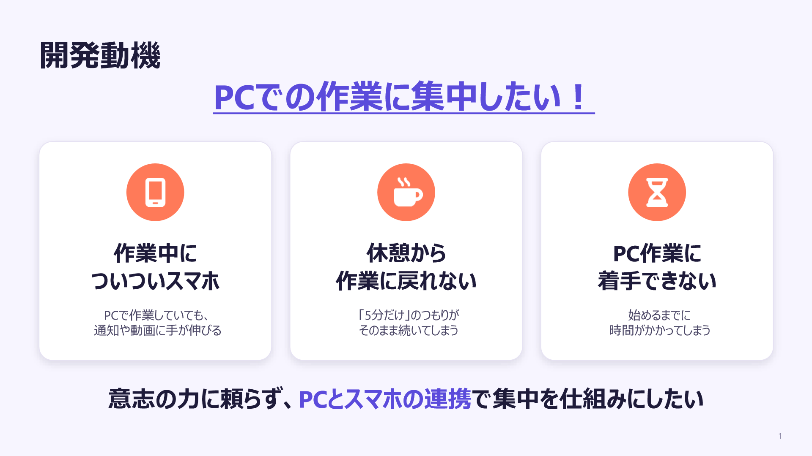
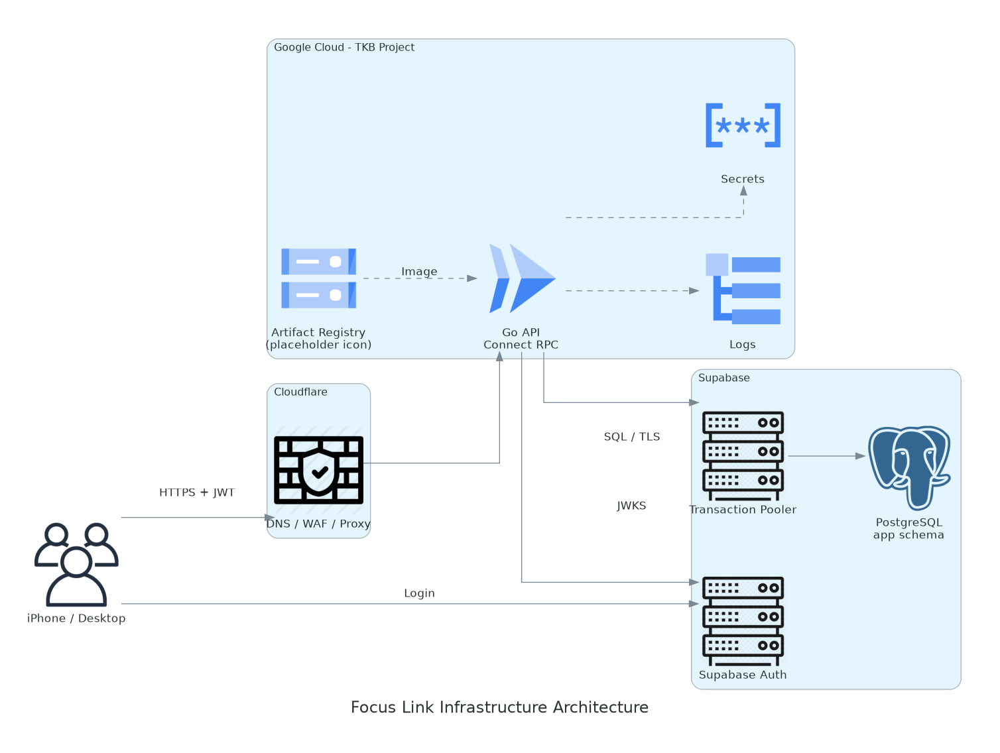

# Focus Link

## 製品概要

### 背景（製品開発のきっかけ・課題）

レポートや研究、プログラミング、業務資料の作成など、PCで進めたい作業があっても、スマートフォンの娯楽に気を取られて着手が遅れたり、途中で脱線したりすることがあります。スマホを一律に禁止するだけでなく、PCでの実作業を自由時間の獲得につなげることで、作業を始めて続ける動機を作れないかと考えました。

### 製品説明（具体的な製品の説明）

Focus Linkは、PCでの作業をスマートフォンの自由時間につなげる、集中習慣支援サービスです。レポートや研究、プログラミング、仕事の資料作成など、取り組みたい作業を設定してPCで作業を始めると、作業中はiPhoneで選んだ娯楽アプリの利用が制限されます。

PCでの作業記録をもとに休憩時間を獲得し、作業を一時停止したときに、その時間を使ってiPhoneを利用できます。作業に取り組んだ分だけ自由時間が得られる仕組みで、「スマホを我慢する」だけではなく、作業の開始と継続を後押しします。学生から、PCで長時間作業する社会人までを対象としています。

### 特長

#### 1. 作業を始める入口を複数用意

PCアプリ起動時の案内や、macOSのメニューバー・Windowsのタスクトレイから作業画面へ進めます。未終了のセッションがあれば、その作業に戻れる設計です。招待制グループのメンバーが作業を始めた通知も、自分の作業を始めるきっかけになります。

#### 2. PC上の作業状況を記録し、結果を見える化

macOSでは、前面アプリや対応ブラウザーのドメイン、入力がない時間を記録し、設定した分類ルールに沿って作業・関連作業・脱線などに分けます。結果画面では時間の内訳と判定の根拠を確認できます。raw URL、ページタイトル、キー入力の内容、画面画像は保存・送信しません。Windowsの作業計測は現在デモモードです。

#### 3. 休憩と作業再開までを一つの流れに

iPhoneでは本人が選んだアプリだけを報酬時間の範囲で利用できます。利用枠は対象アプリを実際に使った時間に応じて減り、作業を再開すると残りの利用枠を閉じて再制限します。グループのメンバー同士で報酬残高を共有せず、作業開始の通知で互いの着手を後押しします。

### 解決できること

- スマホが気になって作業に取りかかれないとき、アプリ起動時の案内や作業開始通知から着手するきっかけを得られます。
- 作業中は選んだ娯楽アプリを制限し、実作業に応じた報酬を休憩に使うことで、作業とスマホ利用に区切りをつけられます。
- 休憩では利用時間の上限を設け、作業再開時には制限を戻すことで、休憩から作業へ戻る流れを作れます。

### 今後の展望

- 作業後の自己評価とPC上の作業記録を組み合わせ、利用者ごとの集中しやすい条件を把握する材料にします。
- 習慣化の状況に合わせて報酬の条件を調整し、固定された条件に慣れて効果が薄れる可能性に対応します。
- 作業ログをタスクの進捗や成果物と結びつけ、PCを操作した時間だけでなく、実際に作業が進んだかも評価できるようにします。

### 注力したこと（こだわり等）

#### アイデア面

- 報酬を仮想ポイントやスマホ内のキャラクター育成ではなく、本人が実際に使いたいスマホの利用時間にしました。作業と報酬の価値を直接結びつける設計です。
- アプリ起動時の案内、メニューバー／タスクトレイからの開始、グループメンバーの開始通知を用意し、本人の意志だけに頼らず作業を始める入口を作ります。

#### 技術面

- バックエンドはモジュラーモノリスとクリーンアーキテクチャを採用し、機能ごとの責務と依存関係を整理しています。単一のアプリケーションとして開発しながら、将来必要になった機能をマイクロサービスへ分割する可能性も見据えています。
- Protocol BuffersでAPIの型を定義し、BufでGo・デスクトップ・iPhone向けのコード生成を管理します。
- クライアントからアプリケーションサーバーへ直接接続せず、Cloudflare WorkerをProxyとして経由します。Workerで許可ルート、認証ヘッダー形式、Content-Type、リクエストサイズを検査し、IP単位のレート制限を行う構成です。workers.devではゾーン単位のWAFを利用できないため、Cloudflare WAFを設定済みとは表現していません。Terraformコードは用意済みですが、クラウドへの適用は未実施です。
- デスクトップはWails v2とReactを組み合わせ、画面とGoによる端末内処理を連携させます。

## 開発技術

### 活用した技術

#### API・データ

- Supabase Auth／Supabase PostgreSQL
- Connect RPC（Protocol Buffers / Bufで定義したAPI）
- Apple Screen Time API（FamilyControls・ManagedSettings・DeviceActivity）による娯楽アプリの制限・一時解除
- Apple Push Notification service（APNs）によるグループの作業開始通知
- Google Cloud Run／Artifact Registry／Secret Manager、Cloudflare Workers、Terraform、GitHub Actions

#### フレームワーク・ライブラリ・モジュール

- バックエンド：Go、connect-go、pgx、sqlc、goose、golang-jwt
- デスクトップ：Wails v2、React 19、TypeScript、Vite、99designs/keyring（macOS Keychain／Windows資格情報ストア）
- iPhone：Swift / SwiftUI、Supabase Swift SDK、WidgetKit

#### デバイス

- macOS・Windows（デスクトップアプリ：作業の設定・計測・結果表示）
- iPhone（報酬時間の利用・娯楽アプリの利用制限・ウィジェット）

### 独自技術

#### ハッカソンで開発した独自機能・技術

- **PC作業ログとセッション報酬の連携**：作業セッションの状態・活動記録・報酬の確定を連携します。[デスクトップの活動同期](desktop/internal/app/activity_sync.go)、[セッション処理](backend/internal/workflow/application/sessions.go)、[報酬ルール](backend/internal/reward/domain/reward.go)
- **iPhoneの利用枠と実利用時間の連携**：Screen Timeの許可・制限状態と利用枠を扱います。[Screen Time制御](mobile/RewardTime/Data/MobileScreenTimeController.swift)、[利用時間モニター](mobile/RewardTime/Data/DeviceActivityUsageMonitor.swift)、[利用枠ドメイン](backend/internal/restriction/domain/restriction.go)。DeviceActivityや期限後の再制限など、実機での受け入れ確認は継続中です。
- **API入口Proxyによるリクエスト検査**：許可ルート・認証形式・リクエストサイズの確認と、IP単位のレート制限を行います。[WorkerのProxy処理](infra/modules/cloudflare/api-endpoint/worker/proxy.js)、[Cloudflare WorkerのTerraform設定](infra/modules/cloudflare/api-endpoint/main.tf)。Terraformの検証は済んでいますが、クラウドへの適用は未実施です。
