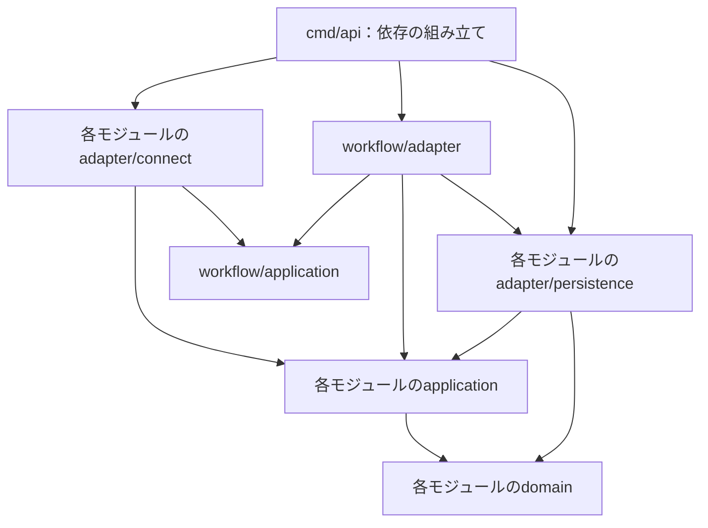

# バックエンド構成

## 1. 方針と現在の実装

バックエンドは，単一のGoアプリケーションを単一のデプロイ単位として扱う**モジュラーモノリス**とする．業務ごとにモジュールを分け，各モジュール内ではクリーンアーキテクチャの依存方向を守る．モジュール間の呼び出しはプロセス内で行い，内部連携のためのRPCやメッセージブローカーは導入しない．Cloud Runで複数インスタンスが動く場合も，この論理構成は変わらない．

本書は今後の業務実装に適用する構成方針であり，以下のディレクトリや機能がすべて実装済みという意味ではない．現在はHTTP／Connectヘルスチェック，DB接続処理，gooseによるUserテーブルの管理のみ実装済み．業務RPC・認証・sqlc／Bufの設定と生成コード・業務モジュールは未実装である．現在の配置と起動手順は[backend README](../../backend/README.md)を参照する．

業務上の意味・不変条件は[ドメインモデル定義](4.ドメインモデル定義.md)，外部との通信契約は[API仕様書](3.API仕様書.md)を正本とする．

認証基盤はSupabase Auth，業務DBはSupabase PostgreSQLを採用する．ドライバー（pgx）・goose・sqlc・ローカルComposeはPostgreSQL向けに移行済みであり，Supabase上での接続検証は未実施．ログイン方法の比較とJWT検証・業務Userへの対応づけは[認証構成](6.認証構成.md)を参照する．

## 2. 技術スタック

| 用途 | 技術・方針 | 役割 |
| --- | --- | --- |
| API | Go / Connect RPC / net/http | 外部クライアントからの要求を受け付ける |
| HTTPルーター | 標準ServeMux．chiは必要になった場合に検討 | ルーティング・Middleware管理 |
| APIスキーマ | Protocol Buffers | 外部APIの通信型を定義する |
| APIコード生成 | Buf | Goサーバー・デスクトップのGoクライアント・iOSクライアント向けの生成を管理する．設定は別途定義 |
| 認証 | Supabase Auth | ログインとトークン発行．Go APIでJWT検証・業務認可を行う |
| DB | Supabase PostgreSQL．ローカルもPostgreSQL | 各モジュールの業務データを同一DBに保存する |
| DBアクセス | sqlc | 業務SQLからGoコードを生成する |
| マイグレーション | goose | SQLスキーマと適用順序を一元管理する |
| ログ | log/slog | 構造化ログを出力する |
| デプロイ | Cloud Run | Go APIアプリケーションを実行する |

## 3. ディレクトリと責務

以下は目標構成である．業務実装に合わせて必要な層から追加し，空のパッケージを先に作る必要はない．

```text
backend/
  cmd/
    api/                         # 起動・依存の組み立て
    migrate/                     # マイグレーション実行
  internal/
    identity/
    focus/
    reward/
      domain/                    # 報酬計算規則・残高の不変条件
      application/               # 報酬付与等の手順・公開操作・必要なインターフェース
      adapter/
        connect/                 # RPCの入力・応答・エラー変換
        persistence/             # Repository実装・SQL・sqlc生成コード
    restriction/
    group/
    notification/
    workflow/
      application/               # モジュール横断の手順・連携ポート・トランザクション抽象
      adapter/                   # 各モジュールへの接続・共通トランザクションの実装
    server/                      # HTTPハンドラー登録・共通Middleware・ヘルスチェック
    database/                    # DB接続などの技術的基盤
  migrations/                    # goose SQL．スキーマの正本
```

6つの業務モジュールはrewardと同じ層構成を基本とする．通知の外部送信など，Connectと永続化以外の外部接続も対象モジュールのadapterに置く．共通基盤に業務ルールや全モジュール共用の業務Repositoryを集めない．

| モジュール | 所有する責務・データ |
| --- | --- |
| identity | ユーザー識別，端末登録，認証主体との対応．既存usersテーブルの所有者 |
| focus | タスク，作業セッション，計測区間，評価結果，終了・中止条件 |
| reward | 報酬ポリシー，計算，付与記録，ウォレット，取引履歴 |
| restriction | 制限設定，利用許可，実利用報告，端末の制限適用状態 |
| group | グループ，招待，所属，参加・退出の権限 |
| notification | 通知イベント・Outbox，抑制規則，配信・再試行，通知先トークン |
| workflow | 記録受理と途中付与，終了時の破棄などの横断手順．業務データの所有権は各モジュールに残す |

同期・冪等性は独立した第7の業務モジュールに集約せず，対象操作を所有するapplicationが担う．横断操作ではworkflowが手順を管理し，操作記録は起点となる業務モジュールが所有する（記録受理・一時停止・終了／中止・開始／再開はfocus，利用枠確保はrestriction）．通信方式や再送の共通部品と，業務上の重複判定を区別する．

## 4. 依存方向と公開境界

次の図の矢印はソースコードの依存方向を示す．実行順序を示すものではない．



- **domain**：エンティティ・値オブジェクト・計算規則・不変条件を保持する．DB，Connect，protobuf，sqlc生成コード，環境変数，他モジュールに依存しない．
- **application**：認可，業務操作の手順，永続化・時刻取得などに必要なインターフェースを定義する．自身のdomainに依存し，adapterには依存しない．
- **adapter/connect**：通信形式の検証と入出力・エラーの変換を行う．認証で得た主体をapplicationへ渡し，業務対象への認可はapplicationで検証する．単一モジュールの操作はそのapplication，横断操作はworkflowの公開操作を呼び出す．ハンドラーに報酬計算や横断手順を置かない．
- **adapter/persistence**：applicationのRepositoryインターフェースを実装する．sqlc生成型とdomain型を変換し，DBエラーを内側で扱うエラーへ変換する．
- **workflow/application**：必要なモジュール操作を連携ポートとして定義し，そのインターフェースを使って横断手順を実行する．SQLや各モジュールの内部実装を参照しない．
- **workflow/adapter**：連携ポートを各モジュールの公開application操作へ接続する．トランザクションに結び付いたRepositoryとapplicationの組み立ても担うが，SQLや業務判断は持たない．

モジュール間で共有する契約は，公開application操作とその入出力に限定する．他モジュールのdomain型，Repository，persistence実装，テーブルを直接利用しない．各業務モジュールからworkflowへの依存も禁止する．他モジュールの情報が必要な場合は利用側が定義したポートを外側で接続し，公開操作から必要な値を取得する．

protobufのメッセージとConnect固有エラーはConnect adapterで扱い，sqlc生成型と`sql.DB`／`sql.Tx`は外側で扱う．公開入出力にはID・秒数・状態などの必要な値を用い，domainエンティティやDB行をそのまま公開しない．生成コードの具体的な配置・生成設定は業務API導入時に決めるが，これらの依存境界は維持する．

Goの`internal`だけでは兄弟モジュール間の参照は禁止できないため，この境界はimportのレビューで確認する．依存検査の自動化は業務パッケージ追加時に検討する．

## 5. 永続化とトランザクション

### テーブルの所有と生成コード

DBは共有するが，各業務テーブルの読み書きは所有モジュールのpersistenceが担う．業務テーブルは非公開のappスキーマに配置し，Supabase管理のauthスキーマとは分離する．クライアントからの業務データ操作はGo API経由に限定する．他モジュールのテーブルを直接JOIN・更新せず，公開操作を通して取得・変更する．マイグレーションは`migrations`に一元管理し，変更ごとに所有モジュールを明確にする．sqlcはgoose SQLをスキーマの正本として参照し，クエリと生成コードは各モジュールのpersistence配下に置く．

### トランザクションの実行契約

単一モジュール内ではapplicationがトランザクション境界を定義し，persistenceが実装する．横断操作ではworkflowが境界を定義する．概念的には「トランザクション内で利用できるモジュール操作一式を受け取るコールバック」を実行するインターフェースとし，具体的なGoシグネチャは実装時に定義する．

外側の実装はDBトランザクションを開始し，同じトランザクションに結び付いた各Repositoryとapplication操作を作ってコールバックへ渡す．各操作は自分の業務ルール・永続化だけを実行し，個別にBegin／Commitしない．すべて成功したときだけ外側がCommitし，途中エラーでは全体をRollbackする．トランザクション内の操作をコールバック終了後に利用してはならない．`sql.Tx`をapplicationやdomainへ渡す必要はない．

横断操作の成功結果・冪等性の記録も同じトランザクションで確定する．DBの一意制約・条件付き更新・競合検知を組み合わせ，二重付与・二重消費・負の残高を防ぐ．複数のCloud Runインスタンスが動くため，プロセス内ロックだけで整合性を保証しない．利用許可発行と作業開始・再開の直列化方式はDB実装時に決め，複数接続で競合を検証する．

### 横断処理の具体例

| workflow | 同一DBトランザクションで確定するもの | コミット後の扱い |
| --- | --- | --- |
| 記録受理・途中付与 | focusの記録・評価範囲，rewardの未付与範囲の計算・付与記録・残高・取引履歴，通知導入時のOutbox／抑制状態，操作結果 | 受理範囲・付与結果を返す．通知送信失敗で報酬を取り消さない |
| 通常終了・中止 | focusの終了条件検証・記録保存・状態，rewardの全未使用残高破棄・取引履歴，restrictionの利用枠失効・制限解除要求，操作結果 | 追加付与せず，端末の解除適用確認までは未確認とする |
| 利用枠確保 | rewardの残高確保・取引履歴，restrictionの利用許可，操作結果 | iPhoneへ許可を返す．端末での解除適用は別途確認する |
| 作業開始・再開 | focusの状態更新，restrictionの未終了利用枠の失効，必要なnotificationのOutbox，操作結果 | 端末への同期・再制限を要求し，適用確認までは制限適用済みとしない．作業の開始・再開自体はサーバー受理後に可能 |

新規開始の残高は0とする．再開時は未充当残高を保持し，失効した利用枠の残りについて返還・追加減算をしない．グループ開始通知を生成するのは新規開始のみで，再開では生成しない．終了・中止時は追加付与せず，未使用残高と残り利用枠をすべて破棄して制限解除を要求する．使用済み分は取り消さず，新規セッションに持ち越さない．途中付与の条件・計算式は未定とする．同じ冪等キーで内容が異なる要求は拒否し，応答喪失後の再送には確定済み結果を返す．

### 通知と外部副作用

通知イベント・Outboxの保存は業務更新と同じトランザクションで行い，APNsなどへの送信はコミット後に行う．未送信記録を永続化し，再起動後にも再試行できるようにする．外部送信をDBトランザクションに含めない．

送信・再試行直前にも，公開操作から作業状態と所属を取得して抑制・配信対象を再確認する．抑制済み通知は後から再送しない．通知生成の重複排除と，外部配信・端末表示の重複排除は別に扱い，外部配信のexactly-onceを仮定しない．Outboxの実行基盤・起動方式は未定であり，Cloud Runのリクエスト終了後にプロセス内goroutineが動き続けることを前提にしない．

## 6. 検証方針と段階的な導入

| 対象 | 業務実装時に確認する内容 |
| --- | --- |
| domain | DBなしで報酬計算・端数処理・残高不変条件・状態遷移を検証 |
| application | ポートのテスト実装で認可・処理順序・冪等性・業務エラーを検証 |
| Connect adapter | 入出力変換，認証主体の引き渡し，エラー変換を検証 |
| persistence | DBで一意制約・条件付き更新・sqlcとの型変換・ロールバックを検証 |
| workflow | 各段階の失敗で部分更新が残らないこと，同時再送，同時利用要求と開始／再開，応答喪失後の再送を検証 |
| notification | Outboxからの再試行，通知の重複排除，送信直前の抑制・所属再確認，通知失敗が業務確定を取り消さないことを検証 |

ヘルスチェックは維持する．DB接続・gooseの方言・ComposeはPostgreSQL向けに移行済みであり，identityモジュールから業務モジュールと生成設定を導入する．ローカルPostgreSQLとSupabaseの実接続でトランザクション・競合制御を検証する．Supabase接続の残作業は[インフラ構成](2.インフラ構成.md)を参照する．

本資料の整備ではコード移動・業務実装・API型やDBスキーマの変更は行わない．途中付与条件・報酬換算率，ログイン方法，返還条件，長時間通信断からの復旧，PC通知配信方式などの未決事項は関連仕様に従い，構成だけを理由に決定しない．

## 7. デスクトップアプリとの境界

デスクトップアプリはWails v2を使用し，端末内GoからConnect RPCで本APIへ接続する．WailsによるWeb UI向けバインディング生成と，BufによるクラウドAPI用コード生成は別の役割とする．端末内Goは計測・画面連携・API呼び出しを担い，Cloud Run上のGoは報酬の最終確定・残高管理を担う．
