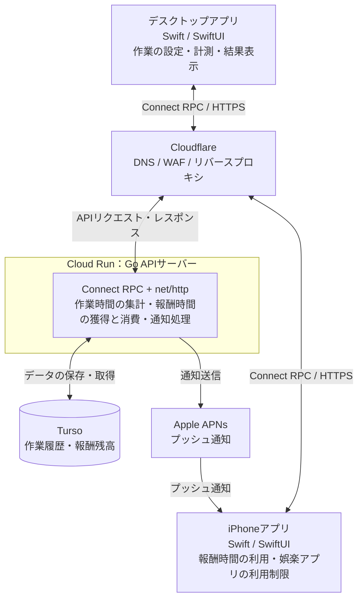

# プロダクト全体像

## 目的と位置づけ

**PCでの頑張りを，スマホの自由時間に変える．**

大学生のレポート・研究・プログラミングなどの作業開始と継続を支援する．デスクトップアプリでの実作業を評価し，獲得した報酬時間をiPhoneのSスマホ利用可能時間として消費する，端末横断型の行動報酬ループを作る．

目的・課題・仮説は[プロダクト戦略](../strategy/1.プロダクト戦略.md)を参照する．本書は採用する構成，各要素の役割，利用の流れを示す．実装済みの状態を示すものではなく，個別の設定や処理の詳細は各仕様書で定義する．

## システム全体図

デスクトップアプリ・iPhoneからのAPI通信はCloudflareを経由してCloud Runに到達する．iPhoneへのプッシュ通知はAPIサーバーからAPNsを経由する別の経路とする．アプリの利用制限・一時解除はiPhoneアプリ側の役割とし，APNsは通知の経路として扱う．

## 各要素の役割と採用技術

| 要素                | 採用技術                    | 役割                                                                         |
| ------------------- | --------------------------- | ---------------------------------------------------------------------------- |
| デスクトップアプリ  | Swift / SwiftUI             | 作業内容・目標時間の設定，作業状況の計測，作業・脱線・保留の内訳と根拠の表示 |
| iPhoneアプリ        | Swift / SwiftUI             | 報酬残高の確認，報酬時間を使った娯楽アプリの一時解除，通知の受信             |
| APIの入口           | Cloudflare                  | DNS・WAF・リバースプロキシ                                                   |
| API実行環境         | Cloud Run                   | Go APIサーバーの実行                                                         |
| APIサーバー         | Go / Connect RPC / net/http | 作業時間の集計，報酬時間の獲得・消費・残高の管理，APNsへの通知送信           |
| API定義・コード生成 | Protocol Buffers / Buf      | API契約の定義とクライアント・サーバー向けコード生成の管理                    |
| データ永続化        | Turso / sqlc / goose        | 作業履歴・報酬残高の保存，SQLからのGoコード生成，DBマイグレーション管理      |
| プッシュ通知        | Apple APNs                  | iPhoneへの通知配信                                                           |

Buf・sqlc・gooseは開発・運用を支えるツールであり，全体図では通信の中継点として描かない．

## 利用とデータの流れ

1. **作業を始める**：デスクトップアプリで「レポートを書く／25分」のように作業内容と目標時間を設定する．
2. **作業を記録する**：デスクトップアプリで作業状況を計測し，APIを通じて作業記録を送る．作業・放置・脱線の判別方法や送信するデータの粒度は別途定義する．
3. **結果と報酬を確認する**：セッション終了後に「作業18分／脱線4分／保留3分」のように根拠付きで表示する．APIサーバーは実作業の評価に基づく報酬時間と残高を管理し，作業履歴とともにTursoへ保存する．
4. **報酬を使う**：iPhoneで獲得した時間を利用する．APIで報酬時間の消費を管理し，iPhone側で対象の娯楽アプリを一時解除する．必要な通知はAPNs経由で届ける．
5. **次の作業につなげる**：作業の成果と獲得した自由時間を確認し，次の作業開始と継続の動機にする．

## 詳細仕様の参照先

| 資料                                          | 詳細を記載する内容                                                                                                            |
| --------------------------------------------- | ----------------------------------------------------------------------------------------------------------------------------- |
| [バックエンド構成](1.バックエンド構成.md)     | Go / Connect RPC / net/httpの構成，Bufによる生成，sqlcによるDBアクセス，gooseによるマイグレーション，集計・報酬管理・通知処理 |
| [インフラ構成](2.インフラ構成.md)             | CloudflareからCloud Runへの接続，Turso・APNsへの接続，環境設定・秘密情報・デプロイ・運用                                      |
| [API仕様書](3.API仕様書.md)                   | アプリとサーバー間のAPI契約，認証，リクエスト・レスポンス，エラー                                                             |
| [ドメインモデル定義](4.ドメインモデル定義.md) | 作業セッション，作業・脱線・保留，報酬時間の獲得・消費・残高の定義                                                            |

作業の判定方法，報酬への換算率，iPhoneの利用制限・解除方式，端末間の同期とオフライン時の扱いは未定とし，本書では固定しない．詳細資料が未記入の項目も，仕様決定済みとは扱わない．
