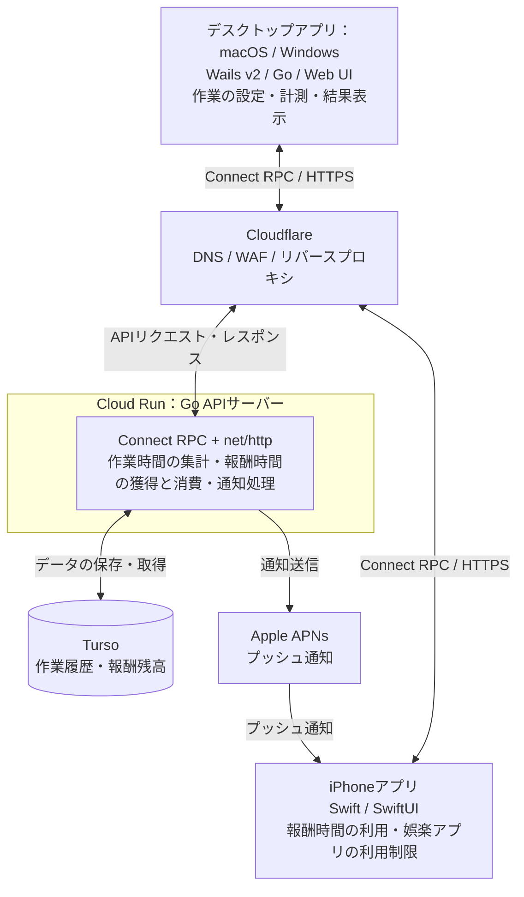

# プロダクト全体像

## 目的と位置づけ

**PCでの頑張りを，スマホの自由時間に変える．**

大学生や社会人のレポート執筆・研究・プログラミング・業務資料の作成など，学業や仕事における作業開始と継続を支援する．デスクトップアプリでの実作業を評価し，獲得した報酬時間をiPhoneのスマホ利用可能時間として消費する，端末横断型の行動報酬ループを作る．

目的・課題・仮説は[プロダクト戦略](../strategy/1.プロダクト戦略.md)を参照する．本書は採用する構成，各要素の役割，利用の流れを示す．実装済みの状態を示すものではなく，個別の設定や処理の詳細は各仕様書で定義する．

## システム全体図

デスクトップアプリ・iPhoneからのAPI通信はCloudflareを経由してCloud Runに到達する．iPhoneへのプッシュ通知はAPIサーバーからAPNsを経由する別の経路とする．アプリの利用制限・一時解除はiPhoneアプリ側の役割とし，APNsは通知の経路として扱う．

## 各要素の役割と採用技術

| 要素                | 採用技術                    | 役割                                                                         |
| ------------------- | --------------------------- | ---------------------------------------------------------------------------- |
| デスクトップアプリ  | Wails v2 / Go / Web UI             | 作業内容・目標時間の設定，作業状況の計測，作業・脱線・保留の内訳と根拠の表示 |
| iPhoneアプリ        | Swift / SwiftUI             | 報酬残高の確認，報酬時間を使った娯楽アプリの一時解除，通知の受信             |
| APIの入口           | Cloudflare                  | DNS・WAF・リバースプロキシ                                                   |
| API実行環境         | Cloud Run                   | Go APIサーバーの実行                                                         |
| APIサーバー         | Go / Connect RPC / net/http | 作業時間の集計，報酬時間の獲得・消費・残高の管理，APNsへの通知送信           |
| API定義・コード生成 | Protocol Buffers / Buf      | API契約の定義とクライアント・サーバー向けコード生成の管理                    |
| データ永続化        | Turso / sqlc / goose        | 作業履歴・報酬残高の保存，SQLからのGoコード生成，DBマイグレーション管理      |
| プッシュ通知        | Apple APNs                  | iPhoneへの通知配信                                                           |

Buf・sqlc・gooseは開発・運用を支えるツールであり，全体図では通信の中継点として描かない．

デスクトップアプリはmacOS・Windowsを対象にWails v2を採用する．画面はWeb技術，端末内の処理はGoで実装する．画面と端末内GoはWailsのバインディング・イベントで連携し，クラウドAPIへのConnect RPC通信は端末内Goが担当する．端末内GoとCloud Run上のGo APIサーバーは別の実行環境であり，報酬の最終確定・残高管理はサーバー側で行う．

OS固有の計測・権限と開発環境の注意点は[デスクトップアプリのREADME](../../desktop/README.md)に整理する．iPhoneアプリはSwift / SwiftUIを継続する．

## 利用とデータの流れ

1. **作業を始める**：PCアプリ起動時のポップアップやグループメンバーの開始通知からタスク画面を開く．「レポートを書く／25分」や「業務の提案資料を作る／25分」のように作業内容・予定時間と最小作業時間を本人が設定する．未終了セッションがあればその画面へ案内する．
2. **作業を記録する**：デスクトップで計測し，開始・一時停止・再開を含む作業状態をAPIへ同期する．作業・放置・脱線の判別方法や送信データの粒度は別途定義する．
3. **本人が終了する**：一時停止を除く計測時間が最小時間以上なら通常終了できる．時間到達で自動終了せず，未達でも報酬なしで中止して履歴を残せる．
4. **結果と報酬を確認する**：通常終了後に作業・脱線・保留の内訳と根拠を表示し，APIで結果と報酬を確定・保存する．作業中・一時停止中の報酬獲得・解除開始通知は破棄し，後から再通知しない．
5. **報酬を使う**：iPhoneで報酬時間を利用枠に充当し，登録アプリ指定／スマホ全体の制限を一時解除する．常時許可アプリを除く対象の実利用時間を消費し，使い切ると再制限する．標準アプリは常時許可するがSafariは対象外とし，指定モードでは選択時，全体モードでは制限する．
6. **次の作業につなげる**：新規開始・一時停止からの再開時に解除枠の残りを破棄して再制限する．未使用の報酬残高は保持する．サーバーでの失効と端末での制限適用は区別し，通信断などで未確認なら完了表示しない．
7. **グループで開始を共有する**：招待制グループを作成し，招待・参加・退出を管理する．新規作業開始を本人以外の現在の参加者のPCとiPhoneへ通知する．この通知は作業中でも受け取れる．

追加要件の導入優先度は未定．PC通知の配信方式は別途定義し，iPhone向けAPNsの経路と区別する．グループの開始共有・通知配信はAPIサーバーが担当し，グループ・所属・招待・通知イベントもTursoに保存する．PCの表示導線はデスクトップ，実利用時間の計測と常時許可・再制限はiPhoneが担当する．

## 詳細仕様の参照先

| 資料                                          | 詳細を記載する内容                                                                                                            |
| --------------------------------------------- | ----------------------------------------------------------------------------------------------------------------------------- |
| [バックエンド構成](1.バックエンド構成.md)     | Go / Connect RPC / net/httpの構成，Bufによる生成，sqlcによるDBアクセス，gooseによるマイグレーション，集計・報酬管理・通知処理 |
| [インフラ構成](2.インフラ構成.md)             | CloudflareからCloud Runへの接続，Turso・APNsへの接続，環境設定・秘密情報・デプロイ・運用                                      |
| [API仕様書](3.API仕様書.md)                   | アプリとサーバー間のAPI契約，認証，リクエスト・レスポンス，エラー                                                             |
| [ドメインモデル定義](4.ドメインモデル定義.md) | 作業セッション，作業・脱線・保留，報酬時間の獲得・消費・残高の定義                                                            |

作業の判定方法，報酬への換算率，iOSでの実利用時間計測・制御の具体的な実装，端末間の同期とオフライン時の扱いは未定とする．制限対象の2モード，実利用時間での消費，作業再開時の残り時間破棄は確定した要求として扱う．詳細資料が未記入の項目も，仕様決定済みとは扱わない．
