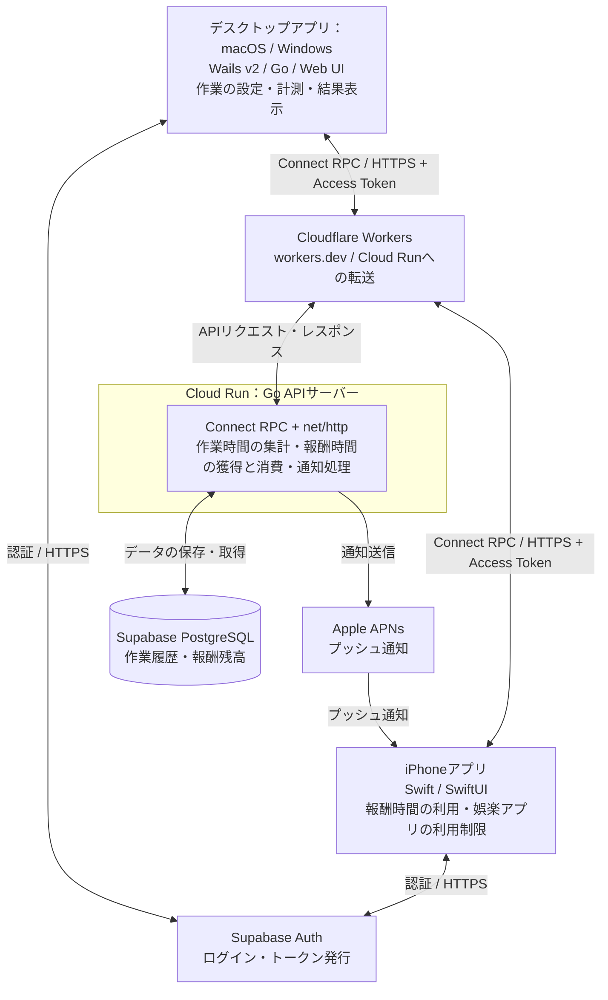

# プロダクト全体像

## 目的と位置づけ

**PCでの頑張りを，スマホの自由時間に変える．**

大学生や社会人のレポート執筆・研究・プログラミング・業務資料の作成など，学業や仕事における作業開始と継続を支援する．デスクトップアプリでの実作業を評価し，獲得した報酬時間をiPhoneのスマホ利用可能時間として消費する，端末横断型の行動報酬ループを作る．

目的・課題・仮説は[プロダクト戦略](../strategy/1.プロダクト戦略.md)を参照する．本書は採用する構成，各要素の役割，利用の流れを示す．実装済みの状態を示すものではなく，個別の設定や処理の詳細は各仕様書で定義する．

## システム全体図

デスクトップアプリ・iPhoneからの業務API通信はCloudflareを経由してCloud Runに到達する．認証通信はSupabase Authへ直接行い，取得したAccess Tokenを業務APIに付与する．業務DBをクライアントから直接操作しない．iPhoneへのプッシュ通知はAPIサーバーからAPNsを経由する別の経路とする．アプリの利用制限・一時解除はiPhoneアプリ側の役割とし，APNsは通知の経路として扱う．

## 各要素の役割と採用技術

| 要素                | 採用技術                    | 役割                                                                         |
| ------------------- | --------------------------- | ---------------------------------------------------------------------------- |
| デスクトップアプリ  | Wails v2 / Go / Web UI             | 作業内容・目標時間の設定，作業状況の計測，作業・脱線・保留の内訳と根拠の表示 |
| iPhoneアプリ        | Swift / SwiftUI             | 報酬残高の確認，報酬時間を使った娯楽アプリの一時解除，通知の受信             |
| APIの入口           | Cloudflare Workers          | `workers.dev`で業務APIを受け，Cloud Runへ転送する                            |
| API実行環境         | Cloud Run                   | Go APIサーバーの実行                                                         |
| APIサーバー         | Go / Connect RPC / net/http | 作業時間の集計，報酬時間の獲得・消費・残高の管理，APNsへの通知送信           |
| API定義・コード生成 | Protocol Buffers / Buf      | API契約の定義とクライアント・サーバー向けコード生成の管理                    |
| 認証基盤 | Supabase Auth | ログイン・セッション・トークン発行．Go APIでJWTを検証 |
| データ永続化        | Supabase PostgreSQL / sqlc / goose        | 作業履歴・報酬残高の保存，SQLからのGoコード生成，DBマイグレーション管理      |
| プッシュ通知        | Apple APNs                  | iPhoneへの通知配信                                                           |

Buf・sqlc・gooseは開発・運用を支えるツールであり，全体図では通信の中継点として描かない．

デスクトップアプリはmacOS・Windowsを対象にWails v2を採用する．画面はWeb技術，端末内の処理はGoで実装する．画面と端末内GoはWailsのバインディング・イベントで連携し，クラウドAPIへのConnect RPC通信は端末内Goが担当する．端末内GoとCloud Run上のGo APIサーバーは別の実行環境であり，報酬の最終確定・残高管理はサーバー側で行う．

OS固有の計測・権限と開発環境の注意点は[デスクトップアプリのREADME](../../desktop/README.md)に整理する．iPhoneアプリはSwift / SwiftUIを継続する．

## 利用とデータの流れ

1. **作業を始める**：PCアプリ起動時のポップアップやグループメンバーの開始通知からタスク画面を開く．「レポートを書く／25分」や「業務の提案資料を作る／25分」のように作業内容・予定時間と最小作業時間を本人が設定する．未終了セッションがあればその画面へ案内する．
2. **作業を記録し報酬を得る**：開始・再開はオンライン必須．サーバー受理後，iPhoneの制限適用確認を待たず計測できるが未確認を表示する．計測記録を定期送信し，サーバーが未付与範囲から途中報酬を確定する．付与条件・計算式は未定．
3. **小休憩を取る**：作業を一時停止し，直前までの記録送信・報酬評価を確認する．iPhoneで残高内の秒数を指定し，登録アプリ指定／スマホ全体の制限を一時解除する．常時許可アプリを除いた実利用時間で消費し，使い切ると再制限する．標準アプリは常時許可するがSafariは対象外とする．
4. **作業を再開する**：利用枠の残りを破棄して再制限する．利用枠に充当していない残高は同じセッション内で保持する．
5. **本人が終了する**：最小作業時間以上なら通常終了でき，未満でも中止できる．時間到達で自動終了しない．終了・中止時は追加付与せず，全未使用残高と残り利用枠を破棄して制限解除を要求する．使用済み分は取り消さず，次セッションへ持ち越さない．
6. **結果と同期状態を確認する**：時間内訳・判定根拠・報酬の獲得・利用・破棄を表示する．オフライン終了は端末に保持し，同期後に解除を進める．サーバー確定と端末適用確認を区別する．作業中・一時停止中の報酬通知は抑制し，終了後も再送しない．
7. **グループで開始を共有する**：招待制グループを作成し，招待・参加・退出を管理する．新規作業開始を本人以外の現在の参加者のPCとiPhoneへ通知する．この通知は作業中でも受け取れる．

追加要件の導入優先度は未定．PC通知の配信方式は別途定義し，iPhone向けAPNsの経路と区別する．グループの開始共有・通知配信はAPIサーバーが担当し，グループ・所属・招待・通知イベントもSupabase PostgreSQLに保存する．PCの表示導線はデスクトップ，実利用時間の計測と常時許可・再制限はiPhoneが担当する．

## 詳細仕様の参照先

| 資料                                          | 詳細を記載する内容                                                                                                            |
| --------------------------------------------- | ----------------------------------------------------------------------------------------------------------------------------- |
| [バックエンド構成](1.バックエンド構成.md)     | Go / Connect RPC / net/httpの構成，Bufによる生成，sqlcによるDBアクセス，gooseによるマイグレーション，集計・報酬管理・通知処理 |
| [インフラ構成](2.インフラ構成.md)             | CloudflareからCloud Runへの接続，Supabase PostgreSQL・APNsへの接続，環境設定・秘密情報・デプロイ・運用                                      |
| [認証構成](6.認証構成.md) | Supabase Auth，ログイン方式の比較，JWT検証，業務Userとの対応 |
| [API仕様書](3.API仕様書.md)                   | アプリとサーバー間のAPI契約，認証，リクエスト・レスポンス，エラー                                                             |
| [ドメインモデル定義](4.ドメインモデル定義.md) | 作業セッション，作業・脱線・保留，報酬時間の獲得・消費・残高の定義                                                            |

作業の判定方法，報酬への換算率，iOSでの実利用時間計測・制御の具体的な実装，送信間隔・計測粒度・長時間通信断からの復旧は未定とする．制限対象の2モード，途中付与と一時停止中の実利用時間での消費，再開時の利用枠破棄，終了・中止時の全未使用報酬破棄と制限解除は確定した要求として扱う．詳細資料が未記入の項目も，仕様決定済みとは扱わない．
