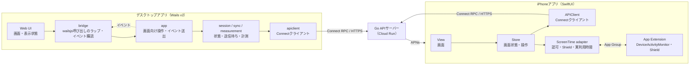
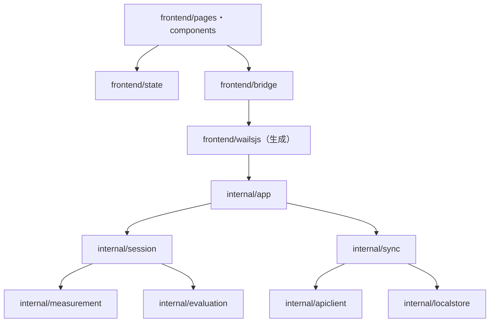

# フロントエンド構成

## 1. 方針と現在の実装

本書は，利用者が操作する2つのクライアント，**デスクトップアプリ**（macOS・Windows，Wails v2）と**iPhoneアプリ**（Swift / SwiftUI）の構成方針を定める．両クライアントとも画面・端末内処理・クラウドAPI連携を層に分け，報酬の確定・残高管理はクラウドを正本とする．クライアントは確定結果を表示し，端末でしかできない計測・制限操作・オフライン時の保持を担う．

デスクトップには共通のWails・React・TypeScript基盤とブラウザ用DemoBridgeがある．macOSではローカル状態と送信待ちの保存，ネイティブ計測，Supabase AuthメールOTP，EnsureUser・PC端末登録・タスクAPI，作業セッションと分類済み区間のConnect同期，macOSメニューバー常駐を実装している．iPhone未登録時は制限を適用せず記録専用セッションを開始する．ReactからAPIへ直接通信しない．

iPhone実機の制限・利用時間計測・再制限，Windowsのネイティブ計測とトレイ，タスク選択設定と分類ルールのクラウド同期，セッション履歴一覧APIは未実装である．実アプリでのOTPログイン・実ログ送信E2Eも未確認である．iPhoneアプリは[iOS報酬時間PoC](../../poc/ios-reward-time/)のみ存在する（本番実装の配置先は[mobile/](../../mobile/)）．

業務上の意味・不変条件は[ドメインモデル定義](4.ドメインモデル定義.md)，通信契約は[API仕様書](3.API仕様書.md)，サーバー側の構成は[バックエンド構成](1.バックエンド構成.md)を正本とする．画面の見た目は[docs/UI](../UI/)のモックアップを参照する．

デスクトップは1つの共通基盤をMac担当者が先行実装し，Mac・WindowsのUIを並行開発する．共通部分・OS別部分の配置，接続契約，引き渡し条件は[デスクトップ共同開発](7.デスクトップ共同開発.md)を参照する．

## 2. 技術スタック

| 対象 | 用途 | 技術・方針 |
| --- | --- | --- |
| デスクトップ | アプリ基盤 | Wails v2.17.0．Go 1.26.10 |
| デスクトップ | 画面 | React 19.3.1・TypeScript 7.0.2・Vite 8.3.5．Mac・Windowsで1つのフロントエンド構成を共有 |
| デスクトップ | 端末内処理 | Go．計測・判定・端末内保存・同期・API呼び出し |
| デスクトップ | 画面と端末内Goの連携 | Wailsのバインディング（画面 → Go）とイベント（Go → 画面） |
| デスクトップ | 端末内保存 | macOSではJSON状態ファイルと活動送信outboxをApplication Support内に保持し，権限を限定する．分類ルール・アプリID・Domainも端末内に保存する |
| iPhone | 画面 | Swift / SwiftUI |
| iPhone | 利用制限 | FamilyControls・ManagedSettings・DeviceActivity．制御可能範囲はPoCで確定 |
| 共通 | API通信 | Connect RPC / HTTPS．デスクトップは端末内Go，iPhoneはSwiftから接続 |
| 共通 | APIクライアント生成 | Buf．デスクトップ用Goクライアント・iPhone用Swiftクライアントを生成．設定は別途定義 |
| iPhone | 通知 | APNs．PCへの通知配信方式は未定 |

Wailsのバインディング生成（`frontend/wailsjs/`）とBufによるクラウドAPI用コード生成は別の役割とする．

## 3. 全体の責務分担

次の図は，クライアント内部の責務と通信経路を示す．



| 責務 | デスクトップ | iPhone | クラウド |
| --- | --- | --- | --- |
| タスク設定・開始・一時停止・再開・終了・中止の操作 | ○ | － | 受理・確定 |
| 作業計測・作業／脱線／保留の推定 | ○ | － | 検証・集計 |
| 報酬の付与・残高・利用枠 | 表示のみ | 表示・利用要求 | 正本 |
| アプリの制限・一時解除・再制限 | － | ○ | 希望状態・許可の管理 |
| 実利用時間の計測 | － | ○ | 報告の受理・照合 |
| 通信断中の記録保持・再送 | ○ | ○（報告） | 重複排除 |

クライアントは残高・付与額を計算して確定値として表示しない．経過時間などの端末ローカルの値と，サーバーで確定した値を画面上で区別する．

## 4. デスクトップアプリ

### 4.1 ディレクトリと責務

以下は目標構成である．Wailsの初期化結果に合わせて調整し，空のパッケージを先に作る必要はない．

```text
desktop/
  main.go                     # wails.Run・ウィンドウ設定・依存の組み立て
  wails.json
  internal/
    app/                      # Wailsにバインドする画面向け操作・イベント送出
    session/                  # 端末側のセッション状態・タイマー・最小時間の表示判定
    measurement/              # 計測の共通インターフェース
      darwin/                 # macOS実装（最前面アプリ・入力・アイドル）
      windows/                # Windows実装
    evaluation/               # 区間の分類・集中度推定・判定根拠の生成
    sync/                     # 送信待ちキュー・操作ID・再送・再同期
    apiclient/                # Buf生成クライアントのラッパー・認証情報の付与・エラー分類
    localstore/               # 端末内保存（送信待ち記録・操作結果・設定）
    tray/                     # メニューバー／タスクトレイ（実現方式は4.4節）
  frontend/
    src/
      pages/                  # 画面単位（4.3節）
      components/             # 共通部品
      state/                  # 画面状態．Goから受け取った値の保持
      bridge/                 # wailsjs呼び出しのラップ・イベント購読と解除
      styles/                 # 共通の色・余白など
      fixtures/               # 両OSで同じ状態を再現するデモデータ
      platforms/
        macos/                # Macの外枠・配置・OS固有スタイル
        windows/              # Windowsの外枠・配置・OS固有スタイル
    wailsjs/                  # Wailsの自動生成．編集禁止
    dist/                     # ビルド成果物．go:embedでバイナリに埋め込む
  build/                      # アイコン・署名・インストーラー設定
```

| パッケージ | 主担当（[機能分担戦略](../strategy/4.機能分担戦略.md)） | 責務 |
| --- | --- | --- |
| measurement，evaluation | B | OS別の計測，取得不能・権限拒否の区別，分類と判定根拠 |
| app，session，sync，apiclient，localstore，frontend | C | 画面操作，状態遷移，送信と再同期，結果表示 |
| tray | C | 常駐表示．方式決定はB・Cで行う |

UI担当のCをMac担当・Windows担当に分け，共通画面・部品・状態管理・bridgeは共有する．`pages`には共通の画面内容を置き，OS別の外枠から使用する．Goの起動設定もOS別ファイルへ分離する．編集担当と並行開発の順序は[デスクトップ共同開発の6節](7.デスクトップ共同開発.md#6-開発の順序と担当)に従う．

### 4.2 依存方向と境界



- **画面（frontend）**：表示と入力だけを担う．クラウドAPIへ直接`fetch`しない．業務判断（終了可否・残高計算など）を持たず，Goから受け取った状態と可否をそのまま表示する．
- **bridge**：`wailsjs`の関数・`EventsOn`を画面から隠し，型変換・購読解除を一か所で扱う．画面コンポーネントから`wailsjs`を直接importしない．
- **app**：Wailsにバインドする唯一の構造体群とする．画面向けの操作を公開し，引数を検証する．バインドされたメソッドはWebView内の任意のコードから呼べるため，内部パッケージを直接バインドしない．
- **session・sync**：端末側の状態遷移と送信待ちを管理する．protobuf型を`app`より外へ出さず，画面には専用の入出力型を返す．
- **measurement**：共通インターフェースとOS別実装に分け，ビルドタグで切り替える．取得不能・権限拒否を「作業なし」や「作業中」に丸めず，判定不能として返す．
- **apiclient**：Buf生成コードを包み，認証情報の付与と[API仕様書](3.API仕様書.md)3節の失敗分類への変換を行う．生成コードの配置はBuf導入時に決める．

OS別の外枠は共通の画面状態・操作窓口を使用する．OS選択は起動の入口へ集約し，セッション状態や報酬表示の処理をOS別に複製しない．Wails接続とブラウザ用デモ接続は同じbridge契約を実装し，実接続の失敗からデモへの自動切替は行わない．

ランタイム関数（ウィンドウ・ダイアログ・イベント）は`OnDomReady`以降に呼び出し，コンテキストは`OnStartup`で保持する．

### 4.3 画面と状態

| 画面（モックアップ） | 主な表示・操作 | 関連要件 |
| --- | --- | --- |
| 起動時ポップアップ（07） | タスク選択・新規設定，最小時間，開始．未終了セッションがあればその画面へ案内 | M-02，M-16 |
| メニューバー：開始前（04） | タスク開始への導線，同期状態 | M-03 |
| メニューバー：作業中（05） | 経過時間，確定済み残高，一時停止・終了・中止，iPhone制限の適用確認状況 | M-03，M-07，M-15 |
| メニューバー：一時停止中（06） | 記録送信・報酬評価の完了待ち／完了，iPhoneで休憩できる状態，再開 | M-08，B-07 |
| 作業後フィードバック（01） | 作業・脱線・保留の時間と根拠，報酬の獲得・利用・破棄，同期待ち表示 | M-14 |
| これまでの記録（02） | 過去セッションの結果一覧 | M-10 |
| 設定（03） | アプリ分類，権限状態と案内，アカウント・端末 | M-01，M-09，N-08 |

バインドする操作とイベントは次を案とする．名前と入出力はAPI契約の確定後に合わせる．

| 種別 | 案 | 内容 |
| --- | --- | --- |
| 操作 | `GetStartupState` | 未終了セッション・送信待ち・権限状態をまとめて返す |
| 操作 | `StartSession`／`PauseSession`／`ResumeSession`／`FinishSession`／`AbortSession` | 対応するAPIを操作IDつきで呼ぶ．開始・再開はオンライン必須 |
| 操作 | `GetSessionResult`，`ListHistory`，`GetSettings`，`UpdateAppClassification` | 結果・履歴・設定の取得と更新 |
| イベント | `session:tick` | 経過時間（端末ローカル値） |
| イベント | `session:state`，`reward:balance` | サーバー確定済みの状態・残高 |
| イベント | `sync:status` | 送信待ち件数，同期失敗，再試行中 |
| イベント | `restriction:state` | iPhoneの希望状態と適用確認状況 |
| イベント | `permission:status` | 計測権限の取得・拒否 |

画面には次の状態を別々に表示し，同じ「完了」表示にまとめない．

| 状態 | 由来 | 表示の扱い |
| --- | --- | --- |
| サーバー確定 | API応答・再同期 | 残高・付与・セッション状態の正式な値 |
| 端末ローカル | session | 経過時間など．確定値と見た目で区別 |
| 同期待ち | sync | オフライン終了（`COMPLETED_LOCAL`／`ABORTED_LOCAL`）や未送信記録．制限解除は同期後 |
| iPhone適用未確認 | `RestrictionState` | 制御リビジョンの適用報告が届くまで「未確認」と表示 |
| 計測不能・権限拒否 | measurement | 正常な作業時間として扱わず，必要な操作を案内 |

一時停止では端末の計測を即停止し，直前までの記録送信とサーバーのPAUSED確定を待ってから「iPhoneで休憩できる」と表示する．記録不足・評価失敗時は失敗と再試行を表示し，休憩可能とは表示しない．

Mac用01〜07のモックは両OSの情報・操作の参考とし，Windowsの外枠・配置はWindows担当が調整する．モックにある固定値・換算率・終了後の残高表示より，業務仕様を優先する．画面デモではデモ表示を明示し，実際の計測・報酬確定・iPhone制限の成功を示すものとしない．

### 4.4 常駐表示とウィンドウ

モックアップはメニューバーからの操作を前提とするが，**Wails v2にはシステムトレイAPIがない**．次のいずれかをPoCで決める．

1. サードパーティのGoパッケージでメニューバー／タスクトレイを実装し，Wailsのウィンドウと連携する．
2. 小さな常駐ウィンドウで代替する．
3. Wails v3（ベータ版）を採用する．現行方針（v2）の変更となるため，全員で判断する．

両OSで，最小化・バックグラウンド移行・スリープ復帰時にもタイマーと計測が継続することを確認する．

共通基盤の引き渡し時点では，通常ウィンドウ内で開始前・作業中・一時停止中の操作を再現できればよい．トレイ方式の決定をUI並行開発の着手条件にせず，ネイティブの常駐方式の採用・検証は別段階で行う．この確認用ウィンドウを最終的な常駐方式の決定とは扱わない．

### 4.5 端末内保存と同期

- 変更要求は送信前に操作IDを発行して端末内に保存し，応答喪失時は同じIDで再送または結果照会する．
- 計測記録はバッチID・連番つきで保存し，定期送信する．終了・中止の残り記録は終了要求に含める．
- 再接続時は[API仕様書](3.API仕様書.md)7節の順で再送・照会し，`GetCurrentSession`・`GetBalance`・`GetRestrictionState`で最新状態を取得してから画面を更新する．
- 保存場所は`os.UserConfigDir()`配下とし，実行ファイルの隣に置かない．キー入力内容・画面画像そのものは保存・送信しない．
- 認証情報はOSの安全な保存領域を候補とし，ログ・平文ファイルに残さない．方式は認証方式の決定後に定める．

## 5. iPhoneアプリ

### 5.1 ディレクトリと責務

以下は`mobile/`配下の目標構成である．Xcodeプロジェクトの作成結果に合わせて調整する．PoCの`RewardRepository`・`RewardStore`の分け方（保存の抽象化と画面状態の分離）を引き継ぐ．

```text
mobile/
  App/
    Features/
      Home/                   # 作業中ホーム（08）
      UseBalance/             # 残高を使う（10）・利用中（11）
      Settings/               # 認可・制限対象・モード（12）
      Group/                  # グループ（13）
    Stores/                   # 画面状態・操作（ObservableObject）
    Services/
      APIClient/              # Buf生成クライアントのラッパー・認証・エラー分類
      ScreenTime/             # FamilyControls・ManagedSettings・DeviceActivityの操作
      Notifications/          # APNs登録・通知からの画面遷移
  Extensions/
    DeviceActivityMonitor/    # 実利用時間の閾値到達での再制限
    ShieldConfiguration/      # 制限画面（09）の表示内容
  Shared/                     # Appと拡張で共有するモデル・App Groupの保存
```

### 5.2 境界

- **View**：表示と入力だけを担い，Storeを通して操作する．
- **Store**：API応答と端末の制限状態を組み合わせて画面状態を作る．残高を端末で増減させず，確定値はAPIから取得する．
- **APIClient**：Connectの呼び出し・操作IDの付与・再送を担う．
- **ScreenTime adapter**：認可，アプリ選択，Shieldの適用・解除，実利用時間の監視を担う．アプリ選択のトークンは端末内（App Group）に保持し，サーバー・PCへ送らない．
- **App Extension**：アプリ本体が起動していなくても，実利用時間の消費完了で再制限できるようにする．再制限をPush通知の到着に依存させない．

本体と拡張は，選択トークン・現在の利用許可・制御リビジョン・未送信の報告をApp Groupで共有する．古い利用枠の消費完了で，新しい制御リビジョン（作業終了による解除など）を上書きしない．

### 5.3 画面と状態

| 画面（モックアップ） | 主な表示・操作 | 関連要件 |
| --- | --- | --- |
| 作業中ホーム（08） | PCの作業状態，確定済み残高，制限状態 | I-05，I-09 |
| 制限画面（09） | Shield．ShieldConfiguration拡張で表示 | I-04 |
| 残高を使う（10） | 一時停止中のみ，残高内の秒数を指定して利用枠を確保 | I-06 |
| 利用中（11） | 残り利用枠，再制限の予告．再開・終了で失効 | I-07，I-08 |
| 設定（12） | Screen Time認可，制限モード，対象アプリ選択 | I-02，I-03，I-12 |
| グループ（13） | 作成・招待・参加・退出 | G-01 |
| 通知の例（14） | 報酬・利用開始・グループ開始通知．作業中・一時停止中の報酬通知は抑制 | B-06，B-08，G-02 |

作業中ホームは`GetCurrentSession`・`GetBalance`・`GetRestrictionState`を使い，同じユーザーのDesktopがサーバーへ確定した作業状態を取得する．Homeタブを表示しているforeground中は30秒間隔で再取得し，アプリ復帰・Homeタブ再表示時にもすぐ更新する．画面を離れている間は定期通信を行わず，background中の同期・通知は別の仕組みとして扱う．

利用枠確保の可否はサーバーの状態（PAUSEDかつ評価済み）で判断し，端末側で推測して確保ボタンを有効にしない．解除適用・再制限の結果は`ReportRestrictionState`・`ReportUsage`で報告し，失敗・権限取消を成功として表示しない．

## 6. 検証方針

| 対象 | 確認する内容 |
| --- | --- |
| デスクトップ起動・連携 | 両OSでビルド・起動し，バインディング呼び出しとイベント通知が動く |
| 常駐表示 | 4.4節の方式で，メニューバー／タスクトレイから開始・一時停止・再開・終了できる |
| 計測 | 権限拒否・取得不能を判定不能として表示し，作業時間に含めない |
| 同期 | 送信前後の切断，応答喪失，再起動で操作IDが維持され，二重操作にならない |
| 表示 | 確定値・ローカル値・同期待ち・適用未確認を区別して表示する |
| iPhone制限 | 認可，Shield，時間付き解除，実利用時間での再制限，再開・終了時の失効・解除を実機で確認 |
| 拡張 | アプリ本体の非起動時・通知未受信時にも再制限できる |

## 7. 未決事項

| 項目 | 必要な決定 |
| --- | --- |
| 画面状態・画面切替 | React・TypeScript・Viteを採用．状態保持・画面切替の具体方式と追加ライブラリの要否は初期化時に決定 |
| 常駐表示 | Wails v2でのメニューバー／タスクトレイの実現方式，v3採用の要否 |
| 対応環境 | macOS・Windows・iOSの対応バージョンとCPUアーキテクチャ |
| 端末内保存 | 保存方式，保持期間，認証情報の保存先 |
| 計測 | OS別の取得手段・権限，送信間隔・粒度 |
| 生成コード | Bufの生成設定と，Go・Swiftクライアントの配置 |
| 通知 | PCへの通知配信方式と，通知からタスク開始画面への遷移 |
| iPhone | 常時許可する標準アプリの一覧，実利用時間の精度，拡張の構成 |

本書は構成だけを理由にこれらを決定しない．決定した内容は本書と関連仕様に反映する．
