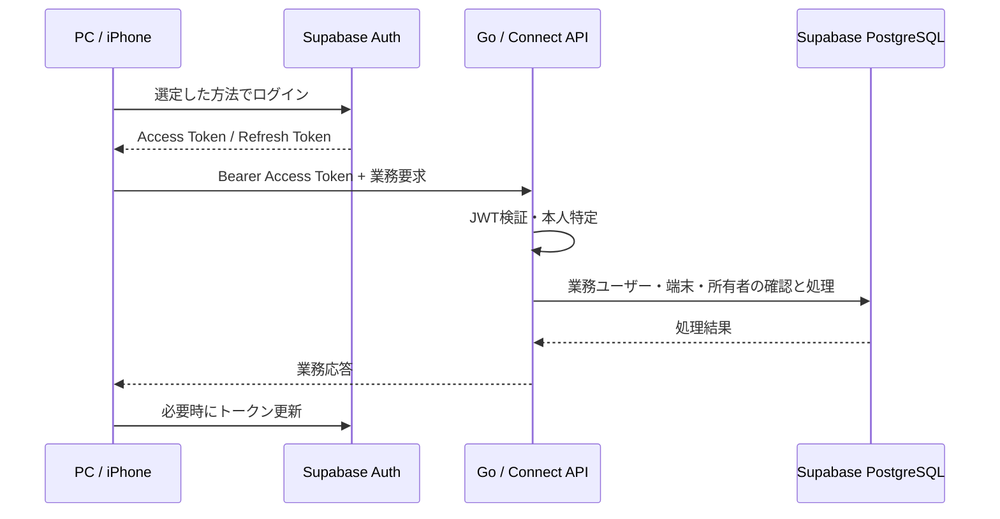

# 認証構成

## 1. 採用方針と実装状況

認証基盤に**Supabase Auth**，業務DBに**SupabaseのPostgreSQL**を採用する．初期版のログイン方式は**メールOTP**とする．Go / Connect RPCのモジュラーモノリスを維持し，認証情報の発行はSupabase Auth，業務上の認可・報酬・残高更新はGo APIが担う．Go APIのJWT検証（JWKSによる署名検証）・業務User登録RPC・PostgreSQL対応はローカル実装済みである．デスクトップとiOSにはメールOTP，`EnsureUser`／`GetMe`の接続コードがある．iOSは未ログイン時にログイン画面を表示し，ログインを後回しにした場合は端末内利用へ進める．保存済みAuth sessionがある場合は起動時に復元し，業務User同期に成功するまでAPI利用画面へ進まない．ただし，Supabase環境・配布設定を含む実環境E2Eは未確認である．

Supabase Authは複数のログイン方法を提供する．認証基盤の採用と利用者向けログイン方法は別に選び，初期版ではメールOTPを使う．[Supabase Auth公式資料](https://supabase.com/docs/guides/auth)

## 2. 選べるログイン方法

| 方法 | 利用者の操作 | このアプリでの判断 |
| --- | --- | --- |
| メール＋パスワード | メールとパスワードを入力 | PC・iPhoneで共通利用できる．メール確認・再設定の導線が必要 |
| メールOTP | メールに届いた確認コードをアプリに入力 | **初期版で採用**．パスワードを覚える必要がなく，別端末でメールを読んでも元のアプリにコードを入力できる |
| Magic Link | メール内のリンクからログイン | コード入力を省ける．ログインを始めた端末・アプリへの復帰経路を検証する必要がある |
| Google／Apple等のソーシャルログイン | 外部アカウントで認証 | 候補．プロバイダー設定とPC・iOSのコールバック，アカウント連携の設計が必要 |
| 電話番号OTP | SMS等で受けたコードを入力 | 候補．電話番号の扱いと配信費用・運用を検討してから採用 |

対応する方式は[Authの方式一覧](https://supabase.com/docs/guides/auth)を参照する．メールOTPとMagic Linkは同じサインイン機能を使うが，メールテンプレートで送る内容が異なる．OTPコードを使う場合はテンプレートに `{{ .Token }}` を設定する．PC・iOSともメールOTPでのSupabase Authユーザー新規作成を許可する（`shouldCreateUser = true`）．iOSでは6桁コードをアプリに入力し，Magic Linkのdeep linkは使わない．

メールを使う方式では，本番向けSMTPを別途設定する．Supabase既定のメール送信は試用向けで，送信先・送信量に制約がある．[SMTP公式資料](https://supabase.com/docs/guides/auth/auth-smtp)

ブラウザ経由のログインを採用する場合はPKCEを利用し，許可するリダイレクトURLを限定する方針．Wailsではシステムブラウザからアプリへ戻す方式，iOSではアプリへの復帰設定を実装前に検証する．iOSネイティブのプロバイダー認証はブラウザ経由とは別に検討する．[PKCE](https://supabase.com/docs/guides/auth/sessions/pkce-flow)，[モバイルのDeep Link](https://supabase.com/docs/guides/auth/native-mobile-deep-linking)

## 3. 認証と業務APIの流れ

端末はSupabase Authでセッションを取得し，Go APIの`Authorization: Bearer <access_token>`へアクセストークンを渡す．Refresh TokenはAuthとの更新に使い，業務RPCへは渡さない．Supabaseのセッションはアクセストークンと更新トークンで構成される．[セッション公式資料](https://supabase.com/docs/guides/auth/sessions)

PCとiPhoneの同時ログインを許可する．両アプリは同じSupabaseプロジェクトで同じメールOTPアカウントを使う．検証済みJWTの同じ`sub`から`EnsureUser`を呼ぶため，別途ペアリングコードを入力する方式ではない．同じメール文字列だけでは足りず，Supabaseプロジェクトとbackend環境も一致させる必要がある．業務上の「未終了作業セッション1件」は認証セッション数の制限ではなく，focusが保証する．デスクトップの認証トークンは`99designs/keyring`を介してmacOS KeychainまたはWindows資格情報ストアへ保存し，WailsのWeb UIへRefresh Tokenを渡さない．資格情報ストアが使えない場合は平文ファイルへフォールバックしない．
iOSはSupabase公式Swift SDKを使用し，セッションはAppleプラットフォームの既定であるKeychain保存を利用する．ログアウトは`.local` scopeでこの端末のセッションを終了し，他端末のセッションを対象にしない．

### Go APIでの検証

非対称署名鍵とJWKSによる検証を採用する．設定済みプロジェクトの公開鍵で署名を検証できるため，Go APIにJWT署名秘密鍵を持たせない．[署名鍵の公式資料](https://supabase.com/docs/guides/auth/signing-keys)

本アプリの検証要件は次の通り．

- JWT検証は外側の認証adapterで行い，Connectの共通処理から呼ぶ．domainにはJWTやSupabase SDK型を渡さず，検証済み主体をapplicationへ渡す．
- 固定したプロジェクトのissuer・audience，署名アルゴリズム，期限，subjectを検証する．トークン内の任意URLから鍵を取得しない．ユーザー用アクセストークンのみ受け入れ，APIキー・匿名ログインを業務ユーザー認証の代わりにしない．
- JWKSをキャッシュし，未知の鍵IDでは制御された再取得を行う．検証できなければ拒否し，鍵更新時のキャッシュ動作をテストする．
- JWTのsubjectをSupabaseユーザーIDとして扱う．メールアドレスやクライアント申告のユーザーIDから本人を決めない．

JWTのissuer・subject・署名検証とJWKSについては[JWT公式資料](https://supabase.com/docs/guides/auth/jwts)を参照する．

ログアウト後も，発行済みJWTのローカル検証だけでは即時失効を保証しない．本アプリでは業務UserのDISABLEDと端末失効状態を毎要求で確認する．Auth側の削除・強制ログアウトの即時反映，JWT有効期限は未決事項として明示し，失効確認方式を実装前に決める．[セッションの有効期間](https://supabase.com/docs/guides/auth/sessions)

## 4. 業務Userとの対応・初回登録の契約案

Supabase管理の`auth.users`と，identity所有の業務Userを分離する．本アプリのUserIDは独立したIDを維持し，`authProvider = supabase`，`authSubject = 検証済みJWTのsub`で対応づける案とする．環境ごとに受け入れるSupabaseプロジェクトを1つに固定する．Google／Apple等のログイン方式を追加する場合も，業務側の `authProvider` は `supabase` とする．複数のログイン方式を連携・統合する方法は，追加前に決定する．

初回登録には`EnsureUser`を追加する契約案とする．検証済み主体から業務Userを冪等に作成／取得し，`GetMe`は参照専用のまま維持する．同時初回ログインでも認証主体の一意制約でUserを増やさない．無効化済みUserは再有効化しない．Authでのサインアップと業務User作成は別トランザクションなので，後者の失敗は再試行して回復する．

認証済み主体の検証はEnsureUserにも必須だが，業務Userが存在することを先に要求しない．その他の業務APIは登録済みUserを要求する．Authテーブルへの業務トリガーや直接更新は行わず，Auth管理と業務マイグレーションを分離する．

端末登録は本人認証とEnsureUserの後に行う．端末登録はAuthセッションに結び付くため，新たにメールOTPでログインした場合は新しい登録IDでPC端末を登録する．ログアウト時はAuthセッションを終了し，端末内のRefresh Tokenを削除する．アカウント削除・複数ログイン手段の連携・進行中作業がある場合のログアウト挙動も未決とする．

## 5. 検証と次の決定

- 改ざん・期限切れ・別プロジェクト・異なるaudienceのJWT，APIキー，匿名ユーザーを拒否する．
- 鍵更新・取得失敗，トークン更新・再ログイン，PCとiPhone同時利用を検証する．
- 初回同時登録の重複防止，未登録・無効User，他人の対象・失効端末を検証する．
- Supabaseの本番SMTP・OTPメールテンプレート，環境変数によるURL／公開キー設定，トークン失効反映は環境構築時に確定する．
- 新規メールと既存メールのOTP，PC・iPhoneの両方でのログイン，Auth sessionの復元，異なるSupabase/backend環境での分離はstagingで受け入れ確認する．
- 一般利用者に接続値を手入力させない．iOS Releaseでは設定画面を表示せず，`Release.local.xcconfig`から`Info.plist`へSupabase Project URL・publishable key・Connect API URLをビルド時に組み込む構成とし，`build-release-simulator.sh`で欠落・placeholder・HTTP URLを拒否し，生成物を検査する．local configの実値を使ったCI／Archive・実機接続は未確認．iOS Debugには開発者向け入力欄がある．Desktopは現在も起動環境変数から接続先を受け取るため，配布版への設定注入・インストーラー導線が未整備で，利用者に環境変数設定を求めない配布手順は未完了．Project URL・publishable key・公開可能なAPI URLはアプリへ含められるが，service-role／secret keyは含めない．
- デスクトップは業務User・PC端末登録とタスク設定に加え，StartSession／GetCurrentSession，活動記録の送信，一時停止・再開・終了・中止，残高・制限状態の取得，セッション履歴へ接続している．有効なiPhoneがない場合は記録専用の`tracking_only`セッションを開始できる．アプリ分類ルールはmacOS端末内で管理する．

DB接続と公開範囲は[インフラ構成](2.インフラ構成.md)，RPCの契約は[API仕様書](3.API仕様書.md)を参照する．
