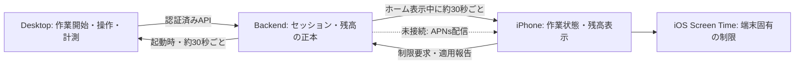

# Desktop・iPhone連携の現状と本番化課題

## 1. 目的と読み方

DesktopとiPhoneへ同じアカウントでログインした場合に共有される情報、端末ごとの機能、未接続・未検証の範囲を整理する。ここでいう「実装済み」はコードに経路があることを示し、実機・staging・本番で動作確認済みという意味ではない。業務上の正本と不変条件は[ドメインモデル定義](4.ドメインモデル定義.md)、API契約は[API仕様書](3.API仕様書.md)、画面・端末側の詳細は[iOSクライアント開発フロー](6.iOSクライアント開発フロー.md)と[mobile README](../../mobile/README.md)を参照する。

## 1.1 デモで最優先に成立させること

同じSupabase project・同じConnect API環境・同じメールアカウントでDesktopとiPhoneへログインしたとき、Desktopで開始した作業がiPhoneホームに表示され、Desktop上のiPhone制限状態も同じユーザーの報告を表示することをデモのP0受け入れ条件とする。画面にログイン済みと出るだけでは連携成立とみなさない。

確認・修正は次の順で行う。同期に失敗した場合は、失敗した段階（Auth session、`EnsureUser`／`GetMe`、Connect API到達性、session取得、画面更新）をログと画面から特定し、再現テストを追加してから修正する。

1. Desktop・iPhoneのSupabase Project URLとConnect APIの環境が一致していることを確認する。Mac Desktopのlocal APIはloopback、実機iPhoneは同じMacのLAN IPv4を使う。Supabase projectとpublishable keyは同じ環境の値を使う。
2. 両方で同じメールOTPアカウントにログインし、それぞれのAuth sessionから`EnsureUser`／`GetMe`が成功することを確認する。トークンや秘密値はログ・報告へ出さない。
3. Desktopから作業を開始し、backend上の同じWorkSessionがiPhoneホームの初回取得または最大約30秒のポーリングで表示されることを確認する。
4. Desktopで一時停止・再開・終了を行い、iPhoneの状態・経過時間・報酬残高がbackend確定値へ追従することを確認する。通信断後の再接続では同じ状態へ収束し、二重計上しないことを確認する。
5. iPhoneから報告した制限状態がDesktopに表示されることを確認する。画面上のサーバー報告とiOS上で実際に適用されたScreen Time制限は別々に受け入れる。

この受け入れが通るまでは「同じアカウントなら連携できる」は仕様・コード上の期待にとどまり、デモで動作確認済みとは扱わない。環境設定の確認だけで解決しない再現があれば、クライアント／backendどちらの境界で途切れたかを特定して修正する。

## 2. 同一アカウントで現在共有できるもの

両アプリが同じSupabaseプロジェクトで認証し、同じConnect API環境を使うと、検証済みSupabase subjectから対応する業務Userを識別する。共有データは端末間で直接送らず、backendを介して読み書きする。

| 情報・操作 | 現在の実装経路 | 現状と制約 |
| --- | --- | --- |
| 認証ユーザー | Supabase AuthのメールOTP、backendのEnsureUser／GetMe | 初回の未認証起動はiPhoneでログイン画面を表示し、OTP要求時に新規Auth user作成も許可する。既存の有効なsessionはKeychainから復元し、業務User同期が完了してからログイン済み画面へ進む。Desktop・iPhoneで同じSupabaseプロジェクトと同じメールOTPアカウントを使えば、検証済みsubjectから同じ業務Userへ対応する。ペアリングコードは不要。異なるlocal／staging／production環境では同じメールでも別環境のデータとなり、環境間のアカウント・データ移行はない。実環境での新規／既存アカウントE2Eは未確認 |
| 作業セッション | Desktopが開始・一時停止・再開・終了・中止をbackendへ送信。iPhoneホームが`GetCurrentSession`を含むAPIを取得 | iPhoneホームはアプリ前景中かつホームタブ表示中に30秒間隔で更新し、前景復帰・手動更新でも取得する。即時Pushではなく最大約30秒の遅れがある。両端末を使うstaging受け入れ確認は別途必要 |
| 報酬残高・履歴 | backendを正本とし、DesktopとiPhoneが残高を読む。両クライアントが作業履歴APIへ接続し、iPhoneは報酬取引履歴APIにも接続 | Desktopは起動時と履歴画面の「更新」から作業履歴を同期する。報酬取引ごとの明細・期間絞り込み・更新時刻表示は未対応。端末内の表示キャッシュはサーバー確定値ではない。 |
| iPhone制限ポリシー・適用状態 | iPhoneが端末登録、ポリシー同期、OS適用状態の報告を行う。Desktopは`GetRestrictionState`で希望状態と適用報告を起動時・30秒間隔で取得し表示する | Appleの選択トークンはiPhone内に保持し、Desktopやbackendへ送らない。表示はbackendが受け取った最新報告であり、iOS上の現在状態を直接検査しない。Desktop表示のstaging受け入れは未実施 |
| 利用枠・実利用時間 | backend APIとiPhone側の予約・利用報告コード | DeviceActivity extension、App Groups、期限後の自動再制限などは実機受け入れが未完了。コードの存在だけでは実際の利用制限を保証しない |
| グループ・作業開始フィード | iPhoneがグループAPIと作業開始フィードを取得 | グループ・公開名・開始事実はbackend経由。Desktop上のグループ表示は未接続。APNsによる通知配信も未接続 |
| 集中ルームWidget | iPhoneがグループ内のRUNNING状態を取得し、App Group経由でWidgetKitへ共有 | WidgetKit拡張・現在の集中メンバーAPIを追加。WidgetKitの更新はシステム予算で遅れることがあり、常時表示・即時反映は保証しない。WidgetKit Pushは未接続 |
| タスク・アプリ分類 | Desktopのタスクはbackend、Macのアプリ分類は端末ローカル | アプリ分類ルールはアカウント間・iPhoneへ同期しない。iPhoneの制限対象アプリも端末固有 |

同じアカウントでログインしただけでは、Screen Timeの許可、選択したアプリ、OS上のShield、通知配信、端末設定は共有・保証されない。共有する対象はbackendに保存された業務データに限られる。

## 3. いま確認できる同期の範囲

- **すでにできる設計・コード経路**：Desktopがサーバー上のWorkSessionを操作し、iPhoneが同じユーザーのセッションと残高を読み取る。iPhoneは端末固有の制限状態をサーバーへ報告し、Desktopは希望状態とiPhoneの報告を取得して表示する。
- **同期方式**：backendを介したポーリングとRPCであり、端末同士の直接接続やリアルタイム配信ではない。ホームを離れている間はホームの定期取得を止める。
- **Desktopの連携表示**：設定画面は認証エラー、iPhone状態報告待ち、iPhone報告受信を区別する。これはアカウント・サーバー状態の表示であり、APNs Push配信やiOS上の制限適用を保証しない。
- **Desktop同期失敗時**：作業記録をMac内の送信待ちキューに保持する。エラー詳細を表示し、画面上の「同期を再試行」から同じキューを再送できる。成功するまで作業状態の競合操作を無効にする。
- **確認が必要**：同一環境・同一アカウントでDesktopから作業を開始し、iPhoneのホーム表示とDesktopのiPhone制限表示が更新されるE2E確認、Pause／Resume／Finish、通信断・再接続、ログアウト・再ログイン、異なるアカウント間の分離。
- **別の受け入れが必要**：iPhoneの制限許可・アプリ選択・Shield、利用枠消費・期限後の再制限。これらをサーバー上のセッション表示確認と同じ完了条件にしない。

## 4. 接続先・アドレスと秘密情報

開発時の接続先は端末ごとに異なる。

| クライアント | local Connect API URL | 理由 |
| --- | --- | --- |
| Mac Desktop | `http://127.0.0.1:8080` | loopbackはMac自身を指す |
| iPhone Simulator | `http://127.0.0.1:8080`（Simulator・Macの構成による） | SimulatorからMacのloopbackへ到達できる開発構成 |
| 実機iPhone | `http://<MacのLAN IPv4>:8080` | iPhoneの`127.0.0.1`はiPhone自身を指す |
| 本番Desktop・iPhone | 同じ公開HTTPS API URL | 端末別localhost・LAN IPは使わず、TLS証明書を有効にする |

Supabase Project URLとpublishable keyは、同じ環境を使う両クライアントで一致させる。URLとpublishable keyはクライアントに含まれうる公開設定値であり、秘密鍵として扱わない。**Supabase service-role／secret key、DBパスワード、JWT署名秘密鍵はクライアントやGitへ置かない。**認可はJWT検証とbackendのユーザー・端末単位の認可で担保する。

現状の設定方式は異なる。Desktopは起動時の`FOCUS_LINK_*`環境変数を読む。iOS Debugはアプリ設定へ保存した接続先を使い、ReleaseはInfo.plistのBuild Settings値をビルド時に組み込む。local API URLやLAN IPを本番配布設定に流用しないこと。Release値もアプリから抽出可能なため、公開可能なURLとpublishable keyだけに限定する。

### 利用者に接続値を入力させないための現在地

- iOSの通常利用者向け画面に接続値入力欄は出さない。入力欄は`DEBUG`ビルドのログイン画面にある「開発者向け接続設定」だけで、Releaseでは非表示。iOS ReleaseのplistにはBuild Settingsから値を読む枠があるが、現在のXcode projectには3つのRelease値を設定する`.xcconfig`／CI注入がない。したがって配布版を作る前に、環境ごとの公開値をビルド設定へ渡す必要がある。
- Desktopアプリは起動環境変数から接続値を読む。開発者は起動前に設定するが、一般利用者向け配布で手入力させないためのインストーラー／環境設定注入はまだ整備されていない。
- Supabase URL・publishable key・公開HTTPS API URLは秘密ではなく、クライアントアプリ内に含まれうる。backend DB資格情報、service-role／secret key、署名鍵は含めない。
- 開発中のMacローカルAPIとLAN IPは開発者の端末に固有であり、利用者向け配布設定として使わない。

## 5. 本番利用までにやること

優先度順に進める。APIや業務ルールの決定が必要な事項は、実装前に担当と仕様を決める。

| 優先度 | 作業 | 完了条件 |
| --- | --- | --- |
| P0 環境を分離 | local／staging／productionのAPI URL、Supabase Project、JWT issuer／audience、DBを明示して分離する。prod接続先はHTTPSにする。 | 各ビルドが意図した環境だけへ接続し、DebugのLAN設定をReleaseへ混入させない。値と秘密の管理者・設定場所を記録する |
| P0 認証と認可を受け入れる | Desktop・iPhoneのOTP、業務User同期、token更新・期限切れ・401/403、ログアウト、アカウント停止をstagingで確認する。端末登録・失効の仕様を確定する。 | 両端末が同じsubject→Userへ対応し、別アカウントのデータを読めず、失効端末を拒否することを確認する |
| P0 状態同期E2E | 同一stagingアカウントでDesktop操作→iPhone反映を確認する。Pause／Resume／Finish／Abort、2台同時操作、通信断、再起動、API応答喪失を含める。 | 状態・版の照合、重複防止、再試行、古い値・同期待ち表示が仕様どおり。表示遅延の許容値を決める |
| P0 Screen Time受け入れ | entitlement／App Groups署名、許可取消、OS再起動・アプリ強制終了、時間超過後の再制限、利用枠の失敗・返還を実機検証する。 | 端末上で制限・解除・再制限が成立し、失敗時に制限済み／利用済みと誤表示しない。未決の返還条件を仕様化する |
| P1 環境設定を安全に配布 | Desktop ReleaseとiOS Releaseの環境設定をビルド・配布経路へ統合し、値のレビュー・誤環境防止をCIで確認する。 | prod URLがHTTPS、秘密鍵が成果物・ソース・ログへ入らない。staging用とprod用の成果物を区別できる |
| P1 運用準備 | DB migrationの適用手順・ロールバック方針、バックアップ／復元、API監視、認証・同期エラーの個人情報を含まないログ、リリース／障害対応を決める。 | 新環境構築から復旧までを手順化し、migration・APIバージョン互換性をリリース前に確認できる |
| P2 連携範囲を拡張 | Desktopへ制限状態・グループ／通知を表示するか決める。APNsやpush／realtimeを導入する場合はポーリングとの役割を決める。 | 必要な共有イベント・表示先・遅延要件・通知抑制・重複防止を仕様化してからAPIとUIを追加する |

**「URLをコードへ直接書かない」だけでは本番化完了ではない。**接続先は環境ごとに選べる設定として管理し、公開可能値と秘密を分け、TLS・認証・認可・環境分離・配布・運用を合わせて受け入れる。

## 6. 次の実装順

1. productionへは接続せず、staging環境とDesktop／iOSの環境設定・JWT検証条件を確定する。
2. stagingで同一アカウントのログインとDesktop→iPhoneのセッション・残高反映をE2E確認する。
3. その後、iPhone Screen Timeを実機で受け入れ、制限の失敗・復旧・返還仕様を確定する。
4. 以上が通った後に、Release接続値・migration・監視・配布手順を整えて本番リリースを準備する。
5. Desktopへの制限表示、グループ画面、APNs通知は、本番前に必要な要件かを決めて独立タスクにする。

## 7. 参照

- [API仕様書](3.API仕様書.md)：API契約、再同期、実装対応表、未決事項。
- [ドメインモデル定義](4.ドメインモデル定義.md)：User・Device・WorkSession・Restrictionの責務と不変条件。
- [iOSクライアント開発フロー](6.iOSクライアント開発フロー.md)：mobileの実装段階、環境・認証・Screen Timeの未決事項。
- [フロントエンド構成](6.フロントエンド構成.md)：Desktop／iPhoneの責務境界と同期方式。
- [Desktop README](../../desktop/README.md)、[mobile README](../../mobile/README.md)：ローカル起動と接続設定の手順。
