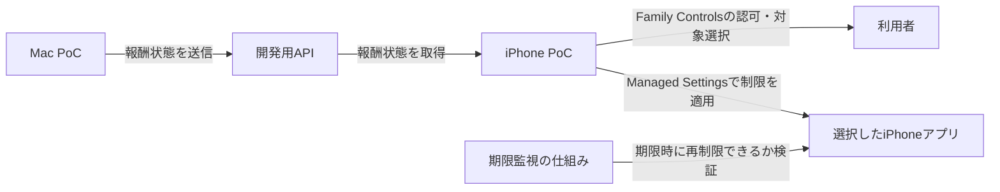

# PoC技術検証戦略

## 目的

PoCでは画面や製品機能を増やすのではなく、プロダクトの前提となる技術が成立するかを最小構成で検証する。

最初に確認するのは次の2点。

1. Macで発生した報酬状態をAPI経由でiPhoneへ届けられる。
2. iPhone上でユーザーが許可した対象アプリに制限をかけ、報酬の期限後に制限を戻せる。

両方が確認できた後に、接続の安定性、実際の報酬計算、認証、製品向けUIなどへ進む。

## 検証する構成

プロダクト全体像ではMacとiPhoneが直接通信せず、双方が同じAPIへHTTPS接続する。MacからiPhoneのOSや他アプリを直接操作する設計ではない。MacはAPIへ状態を送り、iPhoneアプリが状態を受け取って、ユーザーの認可を得たうえでiPhone上の制限を適用する。

[プロダクト全体像](../spec/5.プロダクト全体像.md)と[API仕様書](../spec/3.API仕様書.md)に、Cloudflare経由のGo API、認証、作業セッション・報酬・制限の契約と実装対応表を整理している。初期PoCの疎通確認には報酬状態の送受信に必要な最小APIを使い、本体のGo／Connect APIとは検証対象を分ける。

## 検証フロー

| 順 | 技術上の問い | 最小の検証 | 成功条件 |
| --- | --- | --- | --- |
| 1 | iPhoneで制限機能を利用できるか | iPhoneアプリにFamily Controls capabilityを付け、本人利用の認可を要求する | iPhone上で認可要求が完了し、認可状態をアプリから確認できる |
| 2 | 利用者が選んだアプリを制限・解除できるか | FamilyActivityPickerで1つのアプリを選び、ManagedSettingsでShieldを設定・解除する | 実機の選択したアプリにShieldが表示され、解除操作で消える |
| 3 | MacとiPhoneで同じ報酬状態を共有できるか | Mac PoCが開発用APIへ短い解除状態を送り、iPhone PoCが同じAPIから取得する | Macで送った終了予定時刻をiPhoneで取得し、表示できる |
| 4 | アプリを開いていなくても期限後に再制限できるか | 短い期限を設定し、iPhoneアプリを終了またはバックグラウンドにして、期限後に対象アプリを開く | 通知受信やiPhoneアプリの再起動に頼らず対象アプリが再制限される。使用するiOSの仕組みと制約も記録する |
| 5 | 端末横断の最小ループが成立するか | Mac送信からiPhone取得、対象アプリの解除、期限後の再制限まで一度通す | 一連の状態遷移を実機で再現できる |
| 6 | 友だちの集中状態に応じてウィジェットのキャラクターを切り替えられるか | iPhone上のPoCアプリから集中開始／終了を操作し、App Group経由でWidgetKitウィジェットを更新する | ウィジェットに集中中／休憩中のキャラクター状態が表示され、状態変更後の反映時間と再起動後の表示を記録できる |
| 7 | 集中状態をDynamic Islandに表示できるか | PoCアプリからActivityKit Live Activityを開始・更新・終了する | Dynamic Island対応端末で集中／休憩表示と終了を確認する。非対応端末ではロック画面表示を確認する |

## 現在の進捗

| 検証 | 状態 | 次の確認 |
| --- | --- | --- |
| 1. 本人認可 | 認可ダイアログの表示を確認したが、拒否を選択。許可状態は未確認 | アプリの認可状態を確認し、許可済みになるか実機で検証 |
| 2. アプリ制限 | 選択、Shield設定、解除を追加。実機未確認 | アプリを1つ選び、対象アプリにShieldが出て、解除後に消えるか確認 |
| 3. Mac/API通信 | MacからPOSTが`201 Created`、MacからGETが`200 OK`、iPhoneアプリで仮残高42分の取得を確認 | 完了。PoC APIは同一ローカルネットワークでの通信確認に限定 |
| 4. 期限後の再制限 | DeviceActivity monitor extensionと利用枠API連携のコードを追加。実機未確認 | iPhone実機でApp Groups署名、1分単位イベント、予約時間到達後のShield、extensionコールバック遅延を検証 |
| 5. 端末横断ループ | Desktopのセッション操作・活動同期、Go APIの報酬・制限処理、iPhoneのホーム・利用枠APIを実装 | 同一アカウントのDesktop→iPhone反映と、実機上の解除・再制限を一連で受け入れる |
| 6. 友だち集中ウィジェット | PoCアプリ・Widget Extension・App Group共有のコードを追加し、Simulator向けビルド成功。ホーム画面での表示、App Group署名、反映時間は未確認 | [手順](../../poc/ios-friend-focus-widget/README.md)に従い署名・App Groupを設定して表示し、状態変更とアプリ終了後の反映を確認 |
| 7. Dynamic Island | ActivityKit Live Activityの開始・状態更新・終了とDynamic Island UIを追加。Simulator向けビルド成功、画面表示は未確認 | Device Hubで対応シミュレータ画面を開き、集中／休憩表示、長押し拡大、終了を確認 |

実機ではXcodeからPoCプロジェクトを開き、接続したiPhoneを実行先にして署名・起動する。アプリ内で「本人利用の認可を要求」→「制限するアプリを選択」→「選択したアプリを制限」の順に操作する。対象アプリを開いてShieldを確認した後、PoCへ戻り「このPoCの制限を解除」を押して、対象アプリからShieldが消えることを確認する。Simulatorのビルド成功だけではこの検証を完了としない。

開発署名時にFamily Controls entitlementがプロビジョニングプロファイルに含まれず失敗した場合は、そのエラーを記録する。実機テストではXcodeのSigning & Capabilitiesで対象チームの開発署名が使えることが前提になる。配布entitlementの申請要件とは分けて記録する。

**順1・2・4はiPhone実機で確認する。** Simulatorでビルドできることは、Screen Time機能が実機同様に動く証明にはしない。AppleのScreen Time関連APIはユーザー認可を要し、FamilyActivityPickerの選択をManaged Settingsへ渡して制限する構成を提供する。[Family Controls](https://developer.apple.com/documentation/familycontrols)、[FamilyActivityPicker](https://developer.apple.com/documentation/familycontrols/familyactivitypicker)、[ManagedSettingsのShieldSettings](https://developer.apple.com/documentation/managedsettings/shieldsettings)

期限後の処理は、アプリがフォアグラウンドにいる場合だけでなく、アプリが動いていない場合も調べる。DeviceActivity scheduleとMonitor extensionによる実装を追加したが、App Groups capabilityが両ターゲットのprovisioning profileに含まれること、バックグラウンドでイベントが届くこと、予約時間到達時にShieldが設定されることはiPhone実機で確認する。[DeviceActivityCenter](https://developer.apple.com/documentation/deviceactivity/deviceactivitycenter)、[DeviceActivityMonitor](https://developer.apple.com/documentation/deviceactivity/deviceactivitymonitor)

## PoCに含めるもの

- Macから開発用APIへ状態を送る最小の送信手段
- iPhoneから同じAPIの状態を取得する最小の受信手段
- iPhoneでの本人認可、対象アプリ1つの選択、Shieldの設定と解除
- 期限到達後の再制限方法の実機確認
- 検証結果、発生条件、必要な権限・entitlement、成立しなかった場合の制約の記録
- ウィジェットが状態変化に応じてキャラクターを切り替えられるか、更新までの時間と制約の記録

通信は[全体構成案](../spec/5.プロダクト全体像.md)に合わせてAPI経由で試す。開発用APIは検証に必要な最小状態だけを扱い、DB・本番認証・通知基盤はこのPoCの成立条件にしない。

## PoCに含めないもの

- 作業の自動計測、集中度推定、報酬換算
- 本番向けの画面デザイン、利用履歴、通知
- 製品用のログイン・アカウント管理
- DB、Cloudflare、Cloud Runなど本番インフラ一式
- 正式な報酬消費ルール、オフライン時の処理、複数端末間の競合ルール
- ウィジェット上での常時アニメーションや、友だちの状態を即時反映する保証
- 今回のウィジェットPoCにおける別端末からの集中状態送信、APNsのWidgetKit Push、配信サーバー
- 別端末からLive Activityを開始する処理や、APNs経由のActivityKit Push

## 友だち集中ウィジェットPoCの前提

WidgetKitのウィジェットは常時動作する画面ではない。状態変更の際に表示内容を切り替え、短い遷移アニメーションを付けることはできるが、キャラクターが連続して働き続けるアニメーションや、友だちの状態を即時に届ける保証とは別の機能である。PoCでは同じ端末上のアプリがApp Group共有領域に状態を書き、`WidgetCenter`へ更新を依頼するところまでを先に確かめる。

Dynamic Islandはホーム画面ウィジェットの表示場所を変える機能ではなく、ActivityKitで開始するLive Activityの表示先のひとつである。PoCでは同じ端末のアプリからLive Activityを開始・更新・終了し、Dynamic Island対応シミュレータ／実機で見た目を確認する。Live ActivityはIsland非対応端末でもロック画面などに表示される。[Live Activities](https://developer.apple.com/documentation/activitykit/displaying-live-data-with-live-activities)、[Live Activity対応キー](https://developer.apple.com/documentation/bundleresources/information-property-list/nssupportsliveactivities)

別端末のイベントをウィジェットへ届ける方法としてWidgetKit Pushがあるが、APNsトークンの取得・サーバーからの配信を伴う。これはローカル切替の成立を確認した後の別検証とし、配信遅延や更新頻度の制約を測る。WidgetKitの更新はシステム管理であり、更新依頼が即時反映されることを仕様として約束しない。[Widget更新](https://developer.apple.com/documentation/widgetkit/keeping-a-widget-up-to-date)、[ウィジェットの更新アニメーション](https://developer.apple.com/documentation/widgetkit/animating-data-updates-in-widgets-and-live-activities)、[WidgetKit Push](https://developer.apple.com/documentation/widgetkit/updating-widgets-with-widgetkit-push-notifications)、[App Groups](https://developer.apple.com/documentation/xcode/configuring-app-groups)

既存の [iOS報酬時間PoC](../../poc/ios-reward-time/) はローカルの仮残高・期限表示、Family Controlsの認可とShield操作、PoC APIからの報酬状態取得を試す画面を持つ。Mac/API通信は実機で確認済み。Family Controls認可とShield操作は実機未確認。

## 判定と次の作業

- **成立**：5つの検証条件を実機で確認できたら、API契約とドメインモデルを定義して本体実装へ進む。
- **条件付き成立**：権限、配布entitlement、OSバージョン、バックグラウンド動作などの制約が判明したら、制約を受け入れるか設計を変更するか決める。
- **不成立**：必要な制限または期限後の再制限を実現できない場合は、代替手段を調べるまで本番アプリ実装へ進まない。

Family Controls capabilityはScreen Time APIを使うために必要で、配布前にはAppleへのentitlement申請が必要となる。開発時の実機検証可否と配布申請条件を分けて確認する。[Family Controls entitlementの申請](https://developer.apple.com/documentation/familycontrols/requesting-the-family-controls-entitlement)

## 本体実装への反映と受け入れ項目

- 本体はprotoで定義したGo／Connect APIへ接続し、接続先は環境設定で切り替える。
- iOSの対応バージョンと配布方法は、署名・実機動作の受け入れと合わせて確定する。
- 本体の利用枠は選択アプリの実利用時間で消費し、DeviceActivityの1分単位イベントを報告する。実機精度と期限後のShieldを受け入れ確認する。
- 本体にはoperation IDを保持する再試行、取得失敗時の前回表示と警告、foreground復帰時の再同期を実装している。長時間オフラインとOS再起動後の収束を確認する。
- 本体にはセッション単位の報酬Policy v2、終了・中止時の未使用報酬破棄を実装している。商品仕様としての最終換算率・上限は別途確定する。

PoC内で使う短い時間や固定データは検証用の入力値とし、正式な報酬ルールとして扱わない。
