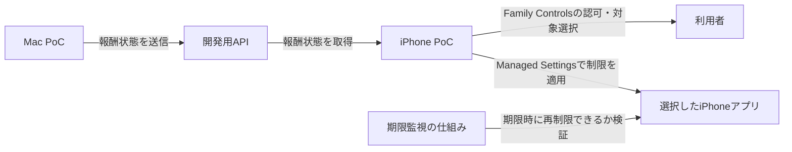

# PoC技術検証戦略

## 目的

PoCでは画面や製品機能を増やすのではなく、プロダクトの前提となる技術が成立するかを最小構成で検証する。

最初に確認するのは次の2点。

1. Macで発生した報酬状態をAPI経由でiPhoneへ届けられる。
2. iPhone上でユーザーが許可した対象アプリに制限をかけ、報酬の期限後に制限を戻せる。

両方が確認できた後に、接続の安定性、実際の報酬計算、認証、製品向けUIなどへ進む。

## 検証する構成

プロダクト全体像ではMacとiPhoneが直接通信せず、双方が同じAPIへHTTPS接続する。MacからiPhoneのOSや他アプリを直接操作する設計ではない。MacはAPIへ状態を送り、iPhoneアプリが状態を受け取って、ユーザーの認可を得たうえでiPhone上の制限を適用する。

既存の[プロダクト全体像](../spec/5.プロダクト全体像.md)はCloudflare経由のGo APIを想定しているが、[API仕様書](../spec/3.API仕様書.md)は未記入である。最初の疎通確認では報酬状態の送受信に必要な最小APIだけを用意し、API契約や認証方式を製品仕様として確定しない。

## 検証フロー

| 順 | 技術上の問い | 最小の検証 | 成功条件 |
| --- | --- | --- | --- |
| 1 | iPhoneで制限機能を利用できるか | iPhoneアプリにFamily Controls capabilityを付け、本人利用の認可を要求する | iPhone上で認可要求が完了し、認可状態をアプリから確認できる |
| 2 | 利用者が選んだアプリを制限・解除できるか | FamilyActivityPickerで1つのアプリを選び、ManagedSettingsでShieldを設定・解除する | 実機の選択したアプリにShieldが表示され、解除操作で消える |
| 3 | MacとiPhoneで同じ報酬状態を共有できるか | Mac PoCが開発用APIへ短い解除状態を送り、iPhone PoCが同じAPIから取得する | Macで送った終了予定時刻をiPhoneで取得し、表示できる |
| 4 | アプリを開いていなくても期限後に再制限できるか | 短い期限を設定し、iPhoneアプリを終了またはバックグラウンドにして、期限後に対象アプリを開く | 通知受信やiPhoneアプリの再起動に頼らず対象アプリが再制限される。使用するiOSの仕組みと制約も記録する |
| 5 | 端末横断の最小ループが成立するか | Mac送信からiPhone取得、対象アプリの解除、期限後の再制限まで一度通す | 一連の状態遷移を実機で再現できる |

## 現在の進捗

| 検証 | 状態 | 次の確認 |
| --- | --- | --- |
| 1. 本人認可 | iOS PoCに認可要求と状態表示を追加。実機未確認 | iPhoneに署名付きでインストールし、認可ダイアログと許可状態を確認 |
| 2. アプリ制限 | 選択、Shield設定、解除を追加。実機未確認 | アプリを1つ選び、対象アプリにShieldが出て、解除後に消えるか確認 |
| 3. Mac/API通信 | 未着手。リポジトリにAPI実装とAPI契約がない | PoC用の最小通信契約を決め、到達可能な開発APIを用意 |
| 4. 期限後の再制限 | 未着手 | DeviceActivity等の候補を実機で比較 |
| 5. 端末横断ループ | 未着手 | 1〜4の結果を受けて実施 |

実機ではXcodeからPoCプロジェクトを開き、接続したiPhoneを実行先にして署名・起動する。アプリ内で「本人利用の認可を要求」→「制限するアプリを選択」→「選択したアプリを制限」の順に操作する。対象アプリを開いてShieldを確認した後、PoCへ戻り「このPoCの制限を解除」を押して、対象アプリからShieldが消えることを確認する。Simulatorのビルド成功だけではこの検証を完了としない。

開発署名時にFamily Controls entitlementがプロビジョニングプロファイルに含まれず失敗した場合は、そのエラーを記録する。実機テストではXcodeのSigning & Capabilitiesで対象チームの開発署名が使えることが前提になる。配布entitlementの申請要件とは分けて記録する。

**順1・2・4はiPhone実機で確認する。** Simulatorでビルドできることは、Screen Time機能が実機同様に動く証明にはしない。AppleのScreen Time関連APIはユーザー認可を要し、FamilyActivityPickerの選択をManaged Settingsへ渡して制限する構成を提供する。[Family Controls](https://developer.apple.com/documentation/familycontrols)、[FamilyActivityPicker](https://developer.apple.com/documentation/familycontrols/familyactivitypicker)、[ManagedSettingsのShieldSettings](https://developer.apple.com/documentation/managedsettings/shieldsettings)

期限後の処理は、アプリがフォアグラウンドにいる場合だけでなく、アプリが動いていない場合も調べる。DeviceActivityのスケジュールとMonitor extensionは候補として検証するが、期限どおりに制御できると事前に仮定しない。[DeviceActivityCenter](https://developer.apple.com/documentation/deviceactivity/deviceactivitycenter)

## PoCに含めるもの

- Macから開発用APIへ状態を送る最小の送信手段
- iPhoneから同じAPIの状態を取得する最小の受信手段
- iPhoneでの本人認可、対象アプリ1つの選択、Shieldの設定と解除
- 期限到達後の再制限方法の実機確認
- 検証結果、発生条件、必要な権限・entitlement、成立しなかった場合の制約の記録

通信は[全体構成案](../spec/5.プロダクト全体像.md)に合わせてAPI経由で試す。開発用APIは検証に必要な最小状態だけを扱い、DB・本番認証・通知基盤はこのPoCの成立条件にしない。

## PoCに含めないもの

- 作業の自動計測、集中度推定、報酬換算
- 本番向けの画面デザイン、利用履歴、通知
- 製品用のログイン・アカウント管理
- DB、Cloudflare、Cloud Runなど本番インフラ一式
- 正式な報酬消費ルール、オフライン時の処理、複数端末間の競合ルール

既存の [iOS報酬時間PoC](../../poc/ios-reward-time/) はローカルの仮残高・期限表示に加え、Family Controlsの認可とShield操作を試す画面を持つ。後者は実機未確認であり、Macとの通信もまだ実装していない。

## 判定と次の作業

- **成立**：5つの検証条件を実機で確認できたら、API契約とドメインモデルを定義して本体実装へ進む。
- **条件付き成立**：権限、配布entitlement、OSバージョン、バックグラウンド動作などの制約が判明したら、制約を受け入れるか設計を変更するか決める。
- **不成立**：必要な制限または期限後の再制限を実現できない場合は、代替手段を調べるまで本番アプリ実装へ進まない。

Family Controls capabilityはScreen Time APIを使うために必要で、配布前にはAppleへのentitlement申請が必要となる。開発時の実機検証可否と配布申請条件を分けて確認する。[Family Controls entitlementの申請](https://developer.apple.com/documentation/familycontrols/requesting-the-family-controls-entitlement)

## 未決事項

- API仕様と通信エンドポイントは未定。
- iOSの対応バージョンと配布方法は未定。
- 解除時間を経過時間と実利用時間のどちらで扱うかは未定。
- API通信が失敗した場合や、iPhoneがオフラインの場合の動作は未定。
- 正式な報酬の獲得・消費ルールは未定。

PoC内で使う短い時間や固定データは検証用の入力値とし、正式な報酬ルールとして扱わない。
