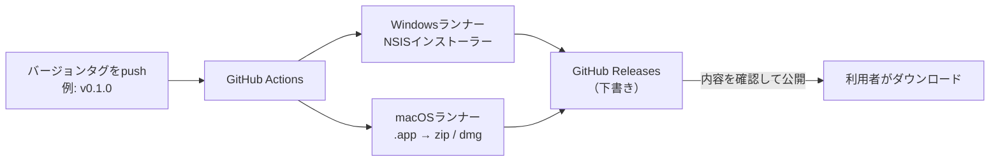

# デスクトップアプリ配布戦略

## 目的と位置づけ

[デスクトップアプリ](../../desktop/README.md)（Focus Link、Wails v2）をmacOS・Windowsの利用者へ届ける方法を定める。配布形式、置き場所、署名、ビルドの自動化を段階ごとに整理する。

現在は方針のみで、配布用ビルド・署名・リリース用CIは未実施である。対応OSバージョン・CPU、常駐方式、自動起動は[デスクトップ共同開発](../spec/7.デスクトップ共同開発.md)の未決事項に従い、本書では確定しない。

## 配布の全体像

- 配布物はリポジトリにコミットせず、**GitHub Releases** の添付ファイルとして配布する。
- タグとアプリのバージョンを一致させる（`v0.1.0` ↔ `0.1.0`）。
- 改ざん・破損の確認用に `SHA256SUMS` を添付する。

## OSごとの配布形式

### Windows

| 形式 | ビルド | 特徴 |
| --- | --- | --- |
| **インストーラー（推奨）** | `wails build -platform windows/amd64 -nsis` | `focus-link-amd64-installer.exe` を出力。スタートメニュー登録・アンインストールに対応し、WebView2ランタイムがない端末では導入を案内する |
| 単体exe | `wails build -platform windows/amd64` | `focus-link.exe` のみ。置くだけで動くが、WebView2がない端末では起動しない |

- インストーラーの作成には `makensis`（NSIS）が必要。Windows向けはLinux・macOSからもクロスビルドできるが、CIではWindowsランナーでビルドし、実機に近い環境で確認する。
- **署名なし**の場合、ダウンロードしたファイルを開くとSmartScreenの「WindowsによってPCが保護されました」が表示される。「詳細情報 → 実行」で起動できる。
- 警告をなくすにはコード署名証明書が必要。Azure Trusted Signing、OV／EVコード署名証明書などの選択肢があり、費用・審査条件は導入時に確認する。

### macOS

| 項目 | 方針 |
| --- | --- |
| ビルド | `wails build -platform darwin/universal`。Intel・Apple Siliconの両方で動く `Focus Link.app` を作る。**macOSでのみビルドできる** |
| 配布形式 | `.app` を zip または dmg に固める |
| 署名なし | ダウンロードしたアプリはGatekeeperにブロックされる（「開発元を検証できません」）。システム設定の「プライバシーとセキュリティ」から利用者が手動で許可する必要がある |
| 正式配布 | Apple Developer Programに加入し、Developer ID Application証明書で署名、Hardened Runtimeを有効化、Appleの公証（notarization）を通し、公証結果をアプリに添付（staple）する |

**このアプリ特有の注意：** 計測ではブラウザのタブ取得などにAutomation権限（Apple Events）を使う（[macOS操作ログPoC](../../poc/macos-native/README.md#automation-権限)）。macOSはこの許可を**アプリの署名主体に紐づけて**記録する。署名なし・アドホック署名ではビルドのたびに別アプリと扱われ、許可のやり直しや、許可が効かない状態が起こりうる。計測機能の実機検証は、配布用と同じ署名主体のビルドで行う。

配布用ビルドには次の設定も必要になる。

- `Info.plist` に `NSAppleEventsUsageDescription`（Automation権限の利用目的の説明）を追加する。
- Hardened Runtimeで配布する場合は、Apple Events entitlement（`com.apple.security.automation.apple-events`）の要否を確認する。
- バンドルIDを自分たちのIDにする。現在の `desktop/build/darwin/Info.plist` はWails既定の `com.wails.{{name}}` のままである。署名・権限の記録はバンドルIDにも紐づくため、最初の署名付き配布の前に確定し、以降は変えない。

## 段階ごとの進め方

| 段階 | 対象者 | Windows | macOS | 完了条件 |
| --- | --- | --- | --- | --- |
| 1. 開発・デモ | チーム内、ハッカソン審査 | 署名なしインストーラー | 署名なしzip | Releasesから入手し、README記載の回避手順で両OSで起動できる |
| 2. 計測の実機検証 | チーム内、協力者 | 署名なしで継続可 | Developer ID署名 | 署名付きビルドでAutomation権限の許可・拒否・再起動後の保持を確認できる |
| 3. 一般配布 | 一般利用者 | コード署名 | 署名＋公証 | 警告なしでインストール・起動でき、更新後も権限が保持される |

段階1では費用をかけず、配布の流れ（タグ → CI → Releases）を先に作る。段階2・3へ進む時期と費用負担は未決とする。

## GitHub Releasesの運用

1. `wails.json` の `info.productVersion` を更新し、mainへマージする。
2. `v<バージョン>` のタグをpushする。
3. GitHub ActionsがWindows・macOSのランナーでビルドし、下書きのReleaseに配布物と `SHA256SUMS` を添付する。
4. 担当者が両OSで配布物を起動確認してから、Releaseを公開する。

| 添付ファイル（例） | 内容 |
| --- | --- |
| `focus-link-<version>-windows-amd64-installer.exe` | Windowsインストーラー |
| `focus-link-<version>-macos-universal.zip` | macOSアプリ |
| `SHA256SUMS` | 各ファイルのSHA-256 |

- リポジトリがprivateの場合、Releasesをダウンロードできるのはアクセス権のある人だけである。外部の利用者へ配る場合は、リポジトリの公開または別の配布先を検討する。
- 署名用の証明書・パスワード、Apple IDの認証情報はGitHub ActionsのSecretsに保存し、リポジトリ・ログに出さない。

## 配布物に含める設定

| 値 | 埋め込み | 理由 |
| --- | --- | --- |
| APIのURL | 可 | 公開されるエンドポイント |
| Supabase Project URL・publishable key | 可 | クライアントに配布する前提の公開用キー |
| Supabase service_role / secret key、DB接続情報 | **不可** | 端末へ配布しない（[インフラ構成](../spec/2.インフラ構成.md)） |

dev・prodで接続先を変える場合は、ビルド時の設定（Goの `-ldflags` 等）で切り替え、配布するのはprod向けビルドだけにする。

## 更新

Wails v2には自動アップデート機能がない。当面は、利用者がReleasesから新しいバージョンを入手して上書きインストールする。起動時に最新バージョンを確認して通知する仕組みは、段階3で必要性を判断する。

## 未決事項

| 項目 | 決める内容 |
| --- | --- |
| 対応OS・CPU | macOS・Windowsの最低バージョン、Windows arm64の要否 |
| macOSの配布形式 | zipかdmgか |
| 署名の時期と費用 | Apple Developer Program・Windowsコード署名証明書の加入時期と負担 |
| バンドルID | `com.wails.*` から変更する正式なID |
| 配布先 | リポジトリの公開範囲と、外部利用者への配布方法 |
| 更新通知 | 起動時の新バージョン確認の要否 |
| 常駐・自動起動 | トレイ／メニューバー常駐、ログイン時の自動起動（[デスクトップ共同開発](../spec/7.デスクトップ共同開発.md)の未決事項） |
