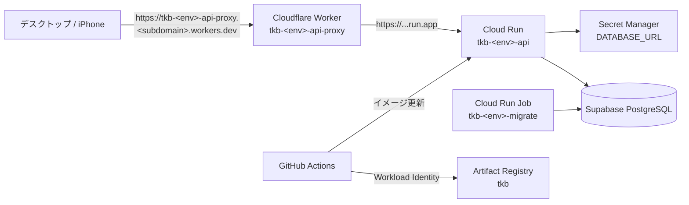

# インフラ（Terraform）

Cloudflare と Google Cloud（GCP）のリソースを Terraform で管理する．目標とするクラウド構成・接続・秘密情報の方針は[インフラ構成](../docs/spec/2.インフラ構成.md)を正本とし，本書は Terraform のディレクトリ構成・管理範囲・運用手順を定める．

**Terraform コードは実装済みで，全ルートモジュールの `terraform validate` が通ることを確認済み．クラウドへの apply は未実施．** GCP プロジェクト・Cloudflare アカウント（workers.dev サブドメイン）・Supabase プロジェクトの用意後に「3. 初期設定」から進める．

## 1. 構成と管理範囲



Cloudflare から Cloud Run への接続は **Cloudflare Workers による転送**を採用した．Worker が API へのリクエストを受け，Cloud Run のデフォルト URL（`run.app`）へ転送する．

費用をかけないため，ドメインは取得せず，Worker を Cloudflare の無料サブドメイン（workers.dev）で公開する．API の URL は `https://tkb-<env>-api-proxy.<subdomain>.workers.dev` となる．Workers の無料枠で動き，ドメイン・LB の費用がかからない．自分のゾーンを持たないため，ゾーン単位の WAF・レート制限・SSL/TLS 設定は使えない．`run.app` URL へ直接アクセスすると Cloudflare を迂回できる点は残る（[5. 未決事項](#5-未決事項)）．

| 対象 | Terraform で管理するもの | Terraform で管理しないもの |
| --- | --- | --- |
| GCP | API 有効化，tfstate 用 GCS バケット，Artifact Registry，Cloud Run サービス・マイグレーション Job の設定，Secret Manager の Secret（器），サービスアカウントと IAM，GitHub Actions 用 Workload Identity 連携 | コンテナイメージのビルド・公開，Cloud Run のイメージ更新，Secret の値 |
| Cloudflare | 転送用 Worker，workers.dev での公開 | アカウントの workers.dev サブドメイン登録，API トークンの発行 |
| Supabase | 対象外 | プロジェクト作成・Auth 設定・DB ロール作成・接続情報の取得（Dashboard で手動） |
| DB スキーマ | 対象外 | backend の goose が正本．`auth` スキーマは Supabase 管理 |

方針:

- **アプリのデプロイとインフラ設定を分ける．** Cloud Run サービス・Job のイメージは CI（`gcloud`）が更新し，Terraform は `lifecycle.ignore_changes` でイメージを差分対象から外す．環境変数・SA・スケール等の設定変更は Terraform で行う．
- **秘密の値を tfstate・リポジトリに入れない．** Secret の器と IAM だけを Terraform で作り，値は `gcloud secrets versions add` で投入する．
- **公開範囲:** Cloud Run は Worker から到達できるよう `invoker_iam_disabled = true` で公開し，利用者の認証は API が Supabase の JWT で行う．
- Cloudflare の API トークン・GCP の認証情報は環境変数（`CLOUDFLARE_API_TOKEN`，ADC）から渡し，`*.tf`・`*.tfvars` に書かない．

## 2. ディレクトリ構成

```text
infra/
├── Makefile                    # init / plan / apply / validate / lock のラッパー
├── bootstrap/                  # API 有効化・tfstate 用 GCS バケット（state はローカル）
├── modules/
│   ├── gcp/cloud-run-api/      # Cloud Run サービス・マイグレーション Job・実行用 SA・Secret
│   └── cloudflare/api-endpoint/  # 転送用 Worker と workers.dev での公開
│       └── worker/proxy.js     # Cloud Run へ転送する Worker
└── envs/                       # 適用単位（ルートモジュール）．1ディレクトリ = 1 state
    ├── backend.hcl.example     # 共通の GCS backend 設定（bucket）の雛形
    ├── shared/
    │   └── gcp/                # Artifact Registry，CI 用 SA・Workload Identity 連携
    ├── dev/
    │   ├── gcp/                # modules/gcp/cloud-run-api を dev 設定で呼ぶ
    │   └── cloudflare/         # modules/cloudflare/api-endpoint を dev 設定で呼ぶ
    └── prod/
        ├── gcp/
        └── cloudflare/
```

各ルートモジュール（`bootstrap/`，`envs/*/*`）は次のファイルで構成する．

| ファイル | 内容 |
| --- | --- |
| `versions.tf` | Terraform `~> 1.14`，google `~> 8.8`，cloudflare `~> 5.28` |
| `providers.tf` | provider 設定．認証情報は書かない |
| `backend.tf` | GCS backend の `prefix`（ディレクトリと一致）．bucket は `envs/backend.hcl` から渡す |
| `main.tf` / `variables.tf` / `outputs.tf` | リソース・モジュール呼び出し，入力，出力 |
| `terraform.tfvars` | 環境固有値（プロジェクト ID・アカウント ID・サブドメイン名等）．`.gitignore` 済みで，雛形の `terraform.tfvars.example` をコミットする |
| `.terraform.lock.hcl` | provider のロック（linux_amd64 / darwin_arm64 / darwin_amd64）．コミットする |

### 構成の考え方

- **プロバイダーごとに state を分ける．** Cloudflare と GCP は認証情報・変更頻度・権限を持つ人が異なるため，同じ環境でも `gcp/` と `cloudflare/` を別 state にする．
- **環境ごとに state を分ける．** dev の apply が prod に波及しないよう別ディレクトリ・別 state とし，差分は `terraform.tfvars` に寄せる．Terraform workspace は使わない．
- **環境をまたぐ共有物は `shared/` に置く．** Artifact Registry・CI 用の認証は dev/prod で共有する．
- **依存は一方向にする．** `envs/<env>/gcp` は `envs/shared/gcp` の出力（CI 用 SA）を，`envs/<env>/cloudflare` は `envs/<env>/gcp` の出力（Cloud Run URL）を `terraform_remote_state` で読むだけで，逆方向の参照は作らない．
- **GCP プロジェクトは dev/prod で1つを共用する．** 環境はリソース名（`tkb-<env>-*`）とラベルで分ける．

### 主なリソース

| スタック | リソース名 | 内容 |
| --- | --- | --- |
| `bootstrap` | `<state_bucket>` | tfstate 用バケット．バージョニング有効，公開アクセス禁止，`prevent_destroy` |
| `envs/shared/gcp` | `tkb`（Artifact Registry） | backend イメージ．最新10件を残し，30日を過ぎた古いイメージを削除 |
| | `tkb-deployer`（SA） | GitHub Actions 用．Artifact Registry への書き込み，`roles/run.developer` |
| | `github` / `github-actions`（WIF） | `jphacks/tkb_2622` リポジトリの OIDC トークンだけを受け付ける |
| `envs/<env>/gcp` | `tkb-<env>-api`（Cloud Run） | API．最小0台，`SUPABASE_JWT_*`・`DB_MAX_CONNECTIONS` を環境変数，`DATABASE_URL` を Secret から渡す |
| | `tkb-<env>-migrate`（Cloud Run Job） | `/app/migrate up` を実行．`MIGRATION_DATABASE_URL` を Secret から渡す |
| | `tkb-<env>-api` / `tkb-<env>-migrate`（SA） | それぞれ自分用の Secret だけを読める |
| | `tkb-<env>-database-url` / `tkb-<env>-migration-database-url`（Secret） | 値は手動投入 |
| `envs/<env>/cloudflare` | `tkb-<env>-api-proxy`（Worker） | workers.dev で受けたリクエストを Cloud Run へ転送．プレビュー用 URL は公開しない |

## 3. 初期設定

### 必要なもの

- Terraform 1.14 以上（`~> 1.14`），`gcloud` CLI，make
- 課金を有効にした GCP プロジェクトと，そのオーナー相当の権限
- Cloudflare アカウントと，その workers.dev サブドメイン（Workers & Pages の Account details で登録）
- dev / prod の Supabase プロジェクト

### プレースホルダーの置き換え

環境ごとの値を入れる `terraform.tfvars` と `envs/backend.hcl` は `.gitignore` 済みで，リポジトリには雛形（`*.example`）だけがある．まず雛形から作成する（既存のファイルは上書きしない）．

```bash
make -C infra setup
```

作成したファイルは `your-...`・`example.com` のプレースホルダーになっている．最初の apply 前に次の値を置き換える．値はチームで共有するが，コミットしない．雛形の項目を増やした場合は，各自 `*.example` との差分を自分のファイルへ反映する．

| 値 | ファイル |
| --- | --- |
| GCP プロジェクト ID（`your-gcp-project-id`） | `bootstrap`，`envs/shared/gcp`，`envs/<env>/gcp` の `terraform.tfvars` |
| tfstate バケット名（`your-gcp-project-id-tfstate`．グローバルに一意） | `bootstrap/terraform.tfvars`，`envs/backend.hcl`，`envs/<env>/*/terraform.tfvars` の `state_bucket` |
| Supabase Auth の issuer | `envs/<env>/gcp/terraform.tfvars` |
| Cloudflare アカウント ID（Dashboard の URL `dash.cloudflare.com/<ID>/...` の32桁） | `envs/<env>/cloudflare/terraform.tfvars` |
| workers.dev サブドメイン名（`<name>.workers.dev` の `<name>`） | `envs/<env>/cloudflare/terraform.tfvars` の `workers_dev_subdomain` |

### 認証

```bash
gcloud auth application-default login           # GCP（Cloudflare スタックの state 読み書きにも必要）
export CLOUDFLARE_API_TOKEN=...                   # Cloudflare スタックのみ
```

Cloudflare の API トークンには，アカウントの「Workers Scripts: Edit」だけを付与する．ゾーンの権限は不要．トークンは `terraform.tfvars` や `TF_VAR_*` で渡さない（Terraform の変数にすると plan ファイルに平文で残るため）．

## 4. 適用手順

`make -C infra <init|plan|apply|output> STACK=<スタック>` で実行する．`plan` は `tfplan` を保存し，`apply` はその plan だけを適用する．prod は plan の内容をレビューしてから apply する．

```text
bootstrap → envs/shared/gcp → envs/<env>/gcp → (Secret 投入・初回デプロイ) → envs/<env>/cloudflare
```

1. **bootstrap**（最初に1回）．state はローカルの `infra/bootstrap/terraform.tfstate` に残る．コミットせず，失った場合は `terraform import` で復元する．

   ```bash
   make -C infra init plan STACK=bootstrap
   make -C infra apply STACK=bootstrap
   ```

2. **共有スタック**．

   ```bash
   make -C infra init plan STACK=envs/shared/gcp && make -C infra apply STACK=envs/shared/gcp
   ```

3. **環境の GCP スタック**．Cloud Run は Secret の最新バージョンを参照するため，値のない状態ではサービスを作成できない．初回だけ Secret を先に作り，値を投入してから全体を適用する．

   ```bash
   make -C infra init STACK=envs/dev/gcp
   terraform -chdir=infra/envs/dev/gcp apply -target='module.api.google_secret_manager_secret.this'

   # 値は標準入力から渡し，シェル履歴に残さない
   gcloud secrets versions add tkb-dev-database-url --data-file=-
   gcloud secrets versions add tkb-dev-migration-database-url --data-file=-

   make -C infra plan STACK=envs/dev/gcp && make -C infra apply STACK=envs/dev/gcp
   ```

   作成直後のサービス・Job はプレースホルダーのイメージ（Google の hello イメージ）で動く．`DATABASE_URL` は API 実行用ロール（トランザクションプーラー），`MIGRATION_DATABASE_URL` は DDL 用ロール（直接接続またはセッションプーラー）の接続 URL とする．

4. **初回デプロイ**．backend のイメージを公開し，マイグレーション Job を実行してから API を更新する（[backend の README](../backend/README.md#cloud-run向けの準備と実行手順)）．

5. **環境の Cloudflare スタック**．`envs/<env>/gcp` の出力（Cloud Run URL）を読んで Worker を作る．

   ```bash
   make -C infra init plan STACK=envs/dev/cloudflare && make -C infra apply STACK=envs/dev/cloudflare
   curl --fail "$(terraform -chdir=infra/envs/dev/cloudflare output -raw api_url)/healthz"
   ```

### GitHub Actions の設定

main に backend の変更が push されると，`.github/workflows/deploy-backend.yml` が dev へデプロイする（イメージのビルド・公開 → マイグレーション Job → API 更新 → Worker 経由で `/healthz` の確認）．Actions のタブから `workflow_dispatch` で手動実行もできる．

リポジトリの Settings → Environments で `dev` を作り，次の Environment variables を登録する（Secret ではなく Variables）．

| 変数 | 値 |
| --- | --- |
| `GCP_PROJECT_ID` | `tkb-2622-dev` |
| `GCP_REGION` | `asia-northeast1` |
| `GCP_WORKLOAD_IDENTITY_PROVIDER` | `terraform -chdir=infra/envs/shared/gcp output -raw workload_identity_provider` |
| `GCP_DEPLOYER_SERVICE_ACCOUNT` | `terraform -chdir=infra/envs/shared/gcp output -raw deployer_service_account_email` |
| `API_URL` | `terraform -chdir=infra/envs/dev/cloudflare output -raw api_url`（Worker の URL．Cloud Run の `run.app` へ直接アクセスすると 403 になるため，ヘルスチェックはこちらを使う） |

Workload Identity 連携は `jphacks/tkb_2622` のトークンしか受け付けないため，fork からは実行できない．

### 検証

```bash
make -C infra validate   # fmt チェックと全スタックの validate（クラウドに接続しない）
make -C infra fmt        # 整形
make -C infra lock       # provider 更新後にロックファイルを再生成
```

## 5. 未決事項

| 項目 | 現状・選択肢 |
| --- | --- |
| `run.app` URL からの迂回 | Cloud Run は公開されており，`run.app` へ直接アクセスすると Cloudflare を通らない．Worker が共有シークレットのヘッダーを付け，API で検証する案がある（backend の対応が必要） |
| レート制限 | workers.dev ではゾーンのレート制限・WAF を使えない．必要になったら Worker の Rate Limiting バインディングで Worker 内に制限を入れる案がある |
| CI のワークフロー | main への push で dev へデプロイ（`.github/workflows/deploy-backend.yml`）．prod は未定 |
| Supabase の Terraform 管理 | 当面は手動．設定項目が増えたら Supabase provider の導入を検討 |
| 監視・アラート | 未設定 |

## 6. 注意

- `.terraform/`，`*.tfstate`，`*.tfstate.*`，`tfplan`，`terraform.tfvars`，`*.auto.tfvars`，`*.secret.tfvars`，`envs/backend.hcl` は `.gitignore` 済み．
- `terraform validate` はクラウドに接続しない．`plan` は既存リソースを読み取るだけで作成しない．`apply` は課金が発生しうるため，対象スタックと plan を確認してから実行する．
- prod の Cloud Run サービス・Job は `deletion_protection = true`．削除する場合は先に `false` へ変更して apply する．
